# QuizRadar

<p align="center">
  
</p>

<p align="center">
  <b>Turn chaotic university class announcements into a calm semester schedule.</b><br/>
  A local-first, zero-server academic radar and productivity suite for university students.
</p>

<p align="center">
  <a href="https://thedragonsoft.github.io/QuizRadar/"><strong>🌐 Official Website</strong></a> •
  <a href="https://thedragonsoft.github.io/QuizRadar/app/"><strong>📱 Launch Web Companion (PWA)</strong></a> •
  <a href="https://thedragonsoft.github.io/QuizRadar/download/"><strong>📦 Download Center</strong></a> •
  <a href="https://github.com/TheDragonSoft/QuizRadar/releases/latest"><strong>🚀 Latest Release (v5.16.0)</strong></a>
</p>

<p align="center">
  <a href="https://github.com/TheDragonSoft/QuizRadar/actions/workflows/ci.yml"></a>
  <a href="https://github.com/TheDragonSoft/QuizRadar/releases/latest"></a>
  <a href="LICENSE"></a>
  <a href="docs/architecture-v5.md"></a>
  <a href="core/"></a>
  <a href="PRIVACY.md"></a>
</p>

---

## 1. What is QuizRadar?

**QuizRadar** is a private, on-device academic radar and semester workspace built for university students. Every semester, students navigate disorganized communication streams: professor emails, LMS posts, Teams chat messages, and syllabus schedules. Announcements arrive with ambiguous date phrases like _"Class Quiz 1 next Tuesday, not this week"_ or mismatched course codes (`CSE241` vs `CS 241`), causing missed deadlines and exam scheduling panic.

QuizRadar solves this entirely on your device:

1. **Fuzzy Timetable Anchor Engine:** Scans course updates across 6 channels, matches primary codes and course aliases, and resolves ambiguous natural language dates into exact timetable lecture and tutorial slots.
2. **Academic Conflict & Cushion Radar:** Flags overlapping deadlines, heavy assessment pileups, and daily study-time deficits (waking hours minus class commitments vs. pending study work) ahead of time.
3. **Complete Non-AI Academic Suite:** Includes a multi-scale **GPA & Course Grade Center**, **Alternating Week Parity (Week A / Week B)** timetables, **Leitner 5-Box Flashcards & Mistake Bank**, **Attendance & Absence Tracker**, and **Printable Vector PDF Exam Cram Sheets**—all running 100% deterministically offline.
4. **Zero-Server Multi-Device Freedom:** All parsing, OAuth token management, and SQLite storage remain strictly on your physical machine. Sync courses, timetables, grades, and assessments across Desktop, Android, and Web using **serverless `quizradar://pair` compressed sync links** or optional **Google Drive AppData** backup—with zero relay servers and zero token sharing.

---

## 2. Live Web & Downloads

| Platform                   | Channel / Artifact                                                                       | Architecture & Notes                                                   |
| :------------------------- | :--------------------------------------------------------------------------------------- | :--------------------------------------------------------------------- |
| **🌐 Official Website**    | [thedragonsoft.github.io/QuizRadar](https://thedragonsoft.github.io/QuizRadar/)          | Product tour, interactive timetable anchor walkthrough, and FAQ        |
| **📱 Web Companion (PWA)** | [thedragonsoft.github.io/QuizRadar/app/](https://thedragonsoft.github.io/QuizRadar/app/) | Zero-install offline web app; runs directly in browser via WebAssembly |
| **🪟 Windows**             | `QuizRadar_<ver>_x64-setup.exe` / `QuizRadar-Portable-win-x64.zip`                       | Minisign-signed in-app auto-updater (`tauri-plugin-updater`)           |
| **🍏 macOS**               | `QuizRadar_<ver>_aarch64.dmg` / `.app.tar.gz`                                            | Apple Silicon native desktop bundle                                    |
| **🐧 Linux**               | `.deb` / `.AppImage`                                                                     | x86_64 native desktop packages                                         |
| **🤖 Android**             | `QuizRadar-v<ver>.apk` / `QuizRadar-v<ver>.aab`                                          | Native Kotlin & Jetpack Compose M3 (`arm64-v8a`, `x86_64`)             |

> 📦 **All binary downloads and signed checksums (`SHA256SUMS.txt`) are available on the [GitHub Releases](https://github.com/TheDragonSoft/QuizRadar/releases) page.**

### Zero-Friction Sign-In Setup

- **Google Sign-In (Gmail, Classroom, Calendar, Drive Backup):** Works out of the box on Desktop and Android with QuizRadar's built-in OAuth PKCE client, or accepts your own custom Google Client ID in `Settings → Sources`.
- **Microsoft Teams:** Uses custom redirect URI handling (`com.quizradar.app://oauth/microsoft` on Android, loopback on Desktop). Paste a free Azure App Registration Client ID in `Settings → Sources`.
- **LMS iCal & Feed Channels (Moodle, Canvas, Blackboard):** Paste your private `.ics` calendar URL or Moodle REST token directly—no OAuth setup required.

---

## 3. Visual Showcase

### Desktop & Mobile Dashboard (`Obsidian`, `Solar`, & `AMOLED` Themes)

|              Desktop Experience (Tauri 2 + React 19)               |             Android Native (Jetpack Compose M3)              |
| :----------------------------------------------------------------: | :----------------------------------------------------------: |
| 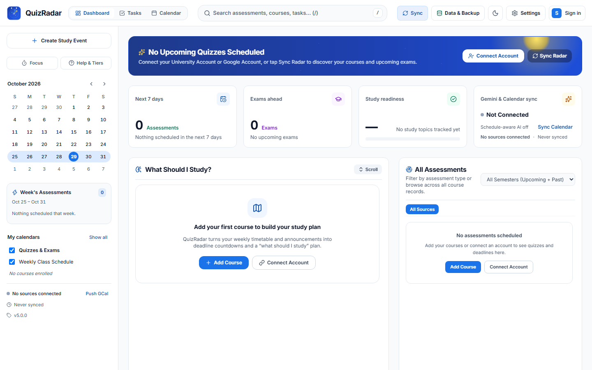 | 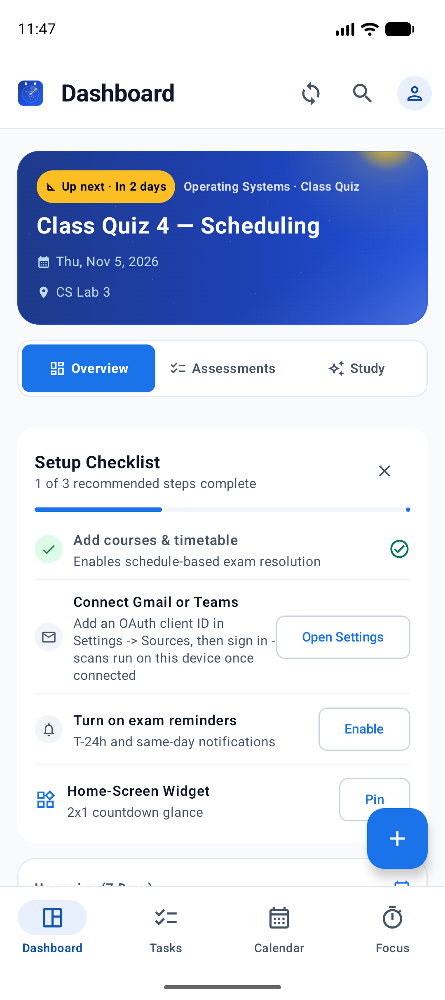 |

### Timetable, Week Parity (Week A / B) & Study Roadmap

|                        Weekly Schedule & Week A/B Parity (Desktop)                        |                          Study Roadmap & Cushion Meter (Desktop)                           |
| :---------------------------------------------------------------------------------------: | :----------------------------------------------------------------------------------------: |
| 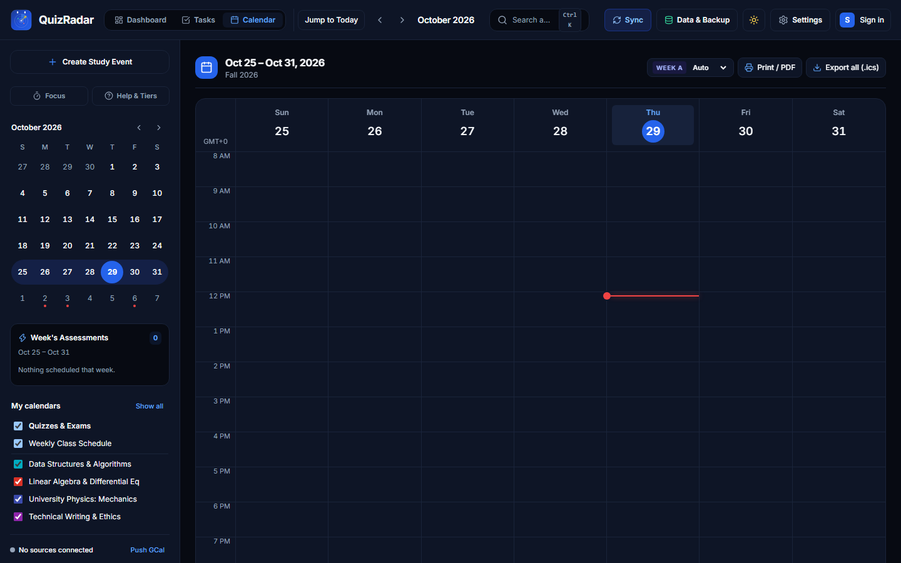 | 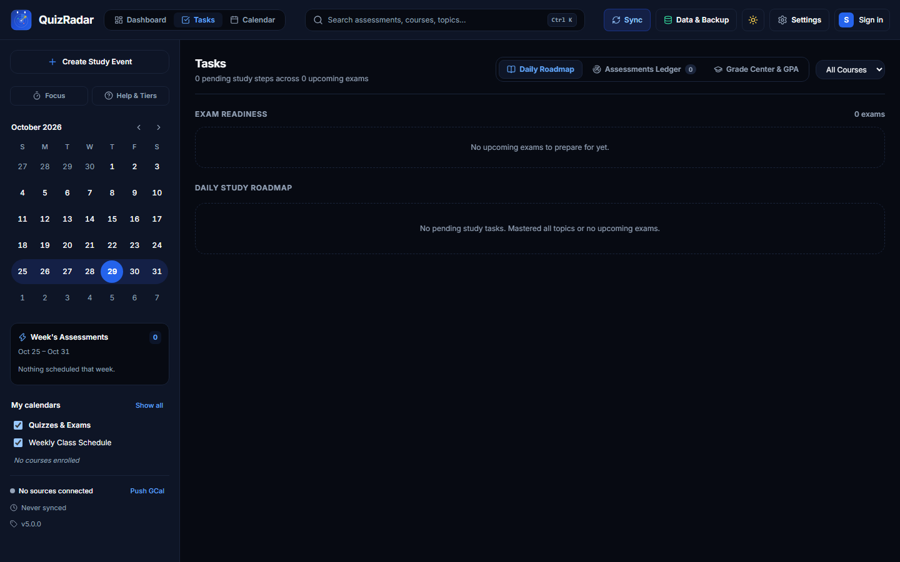 |

### GPA Grade Center, Flashcards & Mistake Bank

|                        Multi-Scale GPA & Grade Center (Desktop)                        |                            Leitner 5-Box Flashcards & Mistake Bank (Desktop)                             |
| :------------------------------------------------------------------------------------: | :------------------------------------------------------------------------------------------------------: |
| 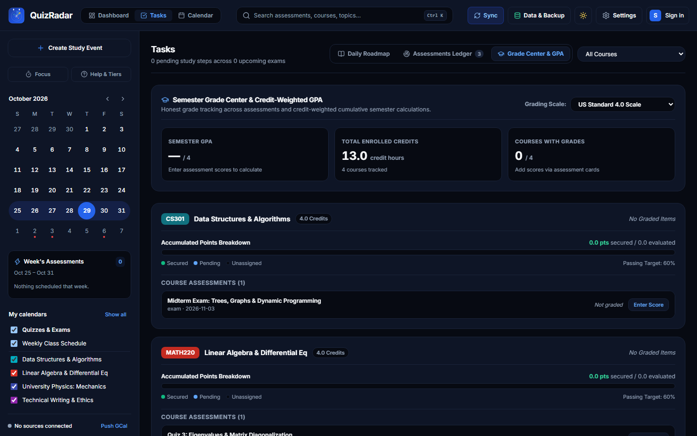 | 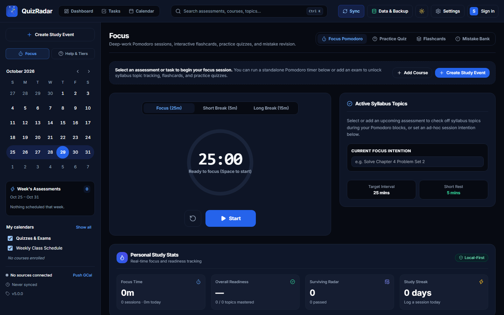 |

### Android Native Suite (Agenda Toggle, Attendance, Focus Streaks)

|                         Android Dashboard & Radar                          |                     Android Agenda View & Attendance                     |                       Android Focus Timer & Study Streaks                        |
| :------------------------------------------------------------------------: | :----------------------------------------------------------------------: | :------------------------------------------------------------------------------: |
| 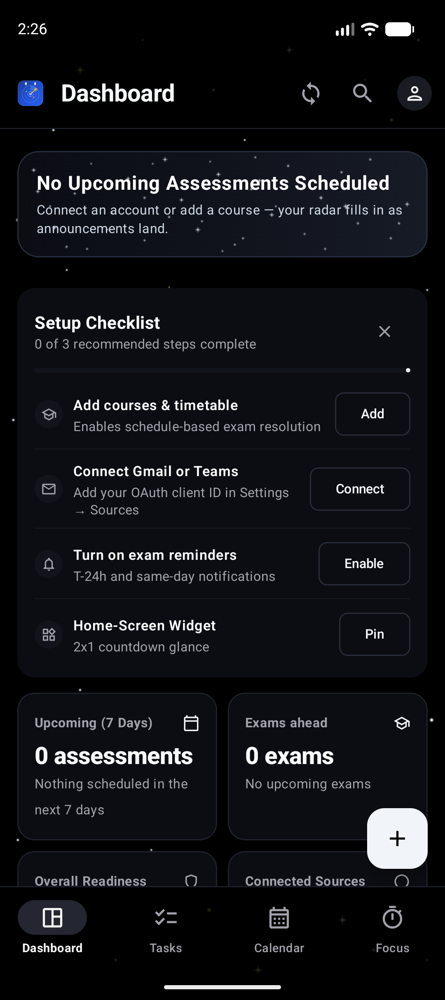 | 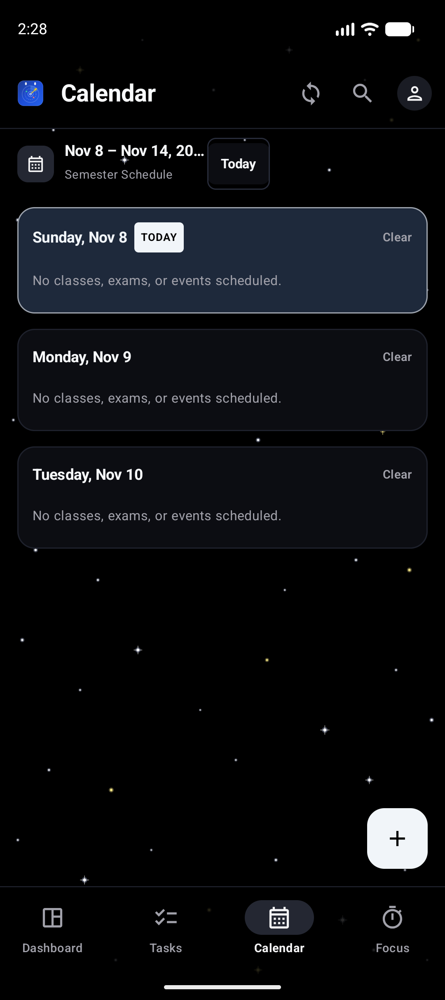 | 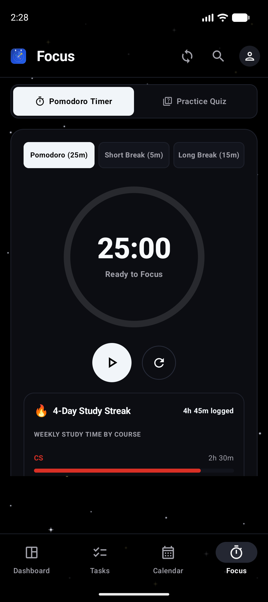 |

<details>
<summary><b>🎨 Click to expand additional themes & views (Obsidian Dark, Solar Golden Hour, Aurora, LMS Guides)</b></summary>

<br/>

|                         Obsidian / Night Skies                         |                           Pure AMOLED Minimal                            |
| :--------------------------------------------------------------------: | :----------------------------------------------------------------------: |
| 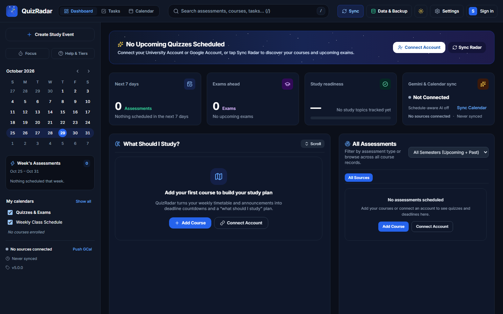 | 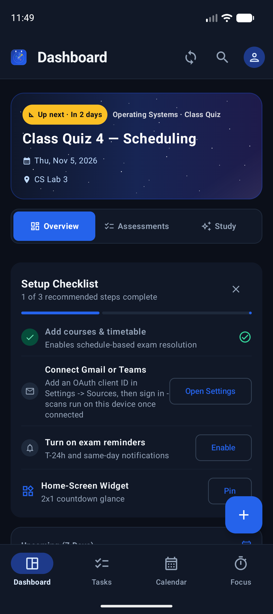 |

|                            Solar Golden Hour Theme                            |                            Aurora Borealis Gradient                             |
| :---------------------------------------------------------------------------: | :-----------------------------------------------------------------------------: |
| 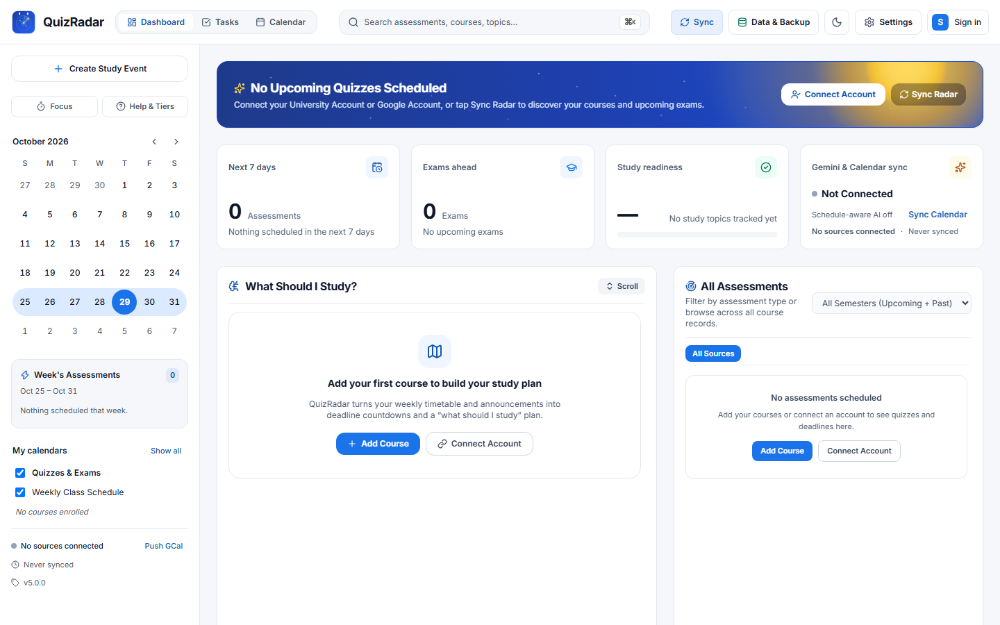 | 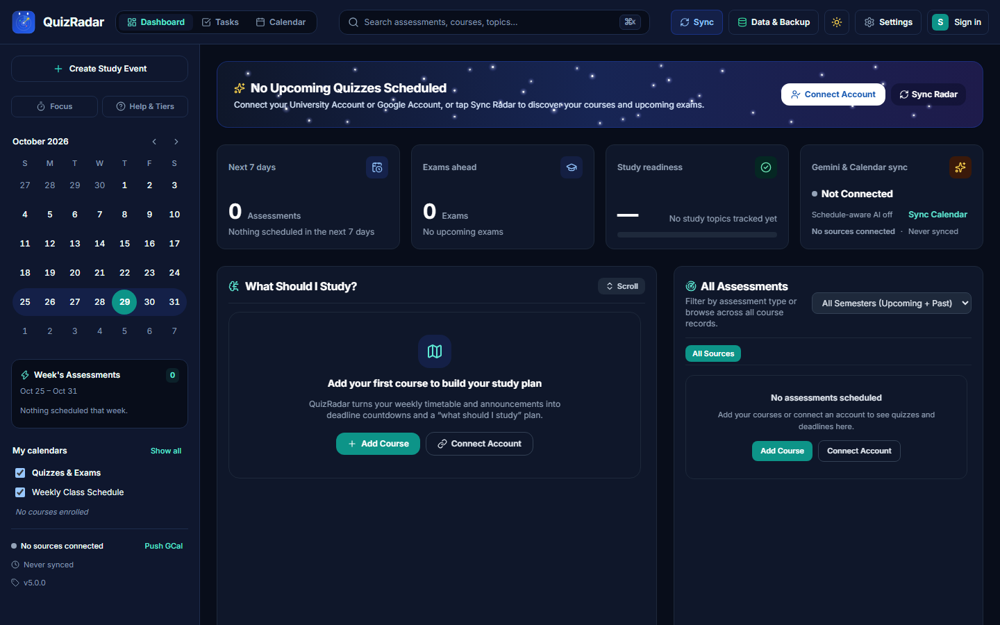 |

|                             LMS Setup & Sync Hub (Desktop)                              |             Android Settings & Integration Hub             |
| :-------------------------------------------------------------------------------------: | :--------------------------------------------------------: |
| 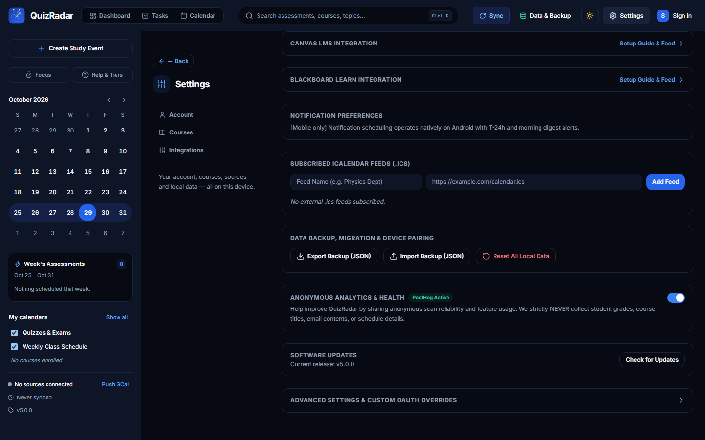 |  |

</details>

---

## 4. Platform Matrix

| Platform                      | Tier      | Shell Architecture                      | Auth & Storage                                                                | Native Features                                                                                                                                                                                                  |
| :---------------------------- | :-------- | :-------------------------------------- | :---------------------------------------------------------------------------- | :--------------------------------------------------------------------------------------------------------------------------------------------------------------------------------------------------------------- |
| **Desktop** (Win, Mac, Linux) | Primary   | **Tauri 2** + **React 19**              | Loopback PKCE OAuth; OS Keyring (`keyring-rs`); SQLite (`SCHEMA_VERSION = 6`) | Signed Auto-Updater (`tauri-plugin-updater`), widescreen split-pane density (`≥1200px`), power-user shortcuts (`1-4`, `T`, `N`, `Space`), `@media print` vector PDF export, `quizradar://pair` sync              |
| **Android** (Phone & Tablet)  | Native    | **Kotlin 2.x** + **Jetpack Compose M3** | Custom-scheme PKCE OAuth; `EncryptedSharedPreferences`; UniFFI SQLite         | On-device announcement scanning, **4×2 Today's Schedule + 2×1 Countdown Glance widgets**, **T-3h persistent lock-screen exam chronometer**, attendance tracker, Share-sheet ingest, `quizradar://pair` deep link |
| **Web Companion** (PWA)       | Companion | **React 19** + **WebAssembly Core**     | Ephemeral GIS tokens (memory-only); IndexedDB object stores (`idbStore`)      | Service Worker offline precaching, full Rust WASM planner/GPA/cushion engine, responsive desktop & mobile layouts, `quizradar://pair` link & JSON import/export                                                  |

---

## 5. Core Capabilities (v5.16.0)

- **Fuzzy Announcement Resolution & Course Aliases:**
  - Cross-references announcement dates against your weekly timetable, anchoring phrases like _"next week"_ or _"the following Tuesday"_ to exact lecture/tutorial slots and room numbers.
  - **Multiple Course Codes & Aliases (`Course.aliases`):** Match announcements across cross-listed or department-variant codes (e.g., `CSE241`, `CS 241`, `COMP-241`).
  - **One-Click Course Reassignment:** Reassign any misclassified or `UNASSIGNED` assessment to the right course and optionally save the detected code as a permanent alias for future scans.
- **6-Channel Multi-Source Ingestion:**
  - **Gmail:** Scans candidate class announcements across targeted queries with intelligent deduplication.
  - **Microsoft Teams:** Microsoft Graph client with heuristics for channel posts.
  - **Moodle LMS:** Connects via REST API token or private iCalendar (`.ics`) webcal subscriptions.
  - **Google Classroom:** Direct ingestion of active coursework, due dates, and classroom announcements.
  - **Canvas & Blackboard LMS:** Guided iCal feed integration with automatic assessment and deadline extraction.
- **Academic Dashboard, Conflict Radar & Study Cushion Engine:**
  - 7-day upcoming assessment KPIs, exam-type breakdown pills, and interactive timeline horizon.
  - **Study Cushion & Deficit Calculator:** Computes daily available study capacity (waking hours minus class and event commitments) against pending study block requirements, surfacing early deficit warnings.
  - **Alternating Week Parity (`Week A` / `Week B`):** Full ISO week parity evaluation, slot recurrence editors, and calendar parity filters for bi-weekly labs and tutorials.
  - **Academic Rhythm Presets:** Tailor lead times and daily study caps with one-click presets (`Medical = 7d`, `Engineering = 5d`, `Business = 3d`, or custom).
- **Multi-Scale GPA & Course Grade Center:**
  - Credit-weighted semester GPA calculator supporting **US 4.0**, **4.33 (A+)**, **5.0**, **10.0**, **UK Honours (First / 2:1 / 2:2 / Third)**, **ECTS**, and **Percentage** scales.
  - Record achieved component scores and run **What-If Projections** to see the exact final exam score needed for your target grade.
- **Active Recall, Spaced Repetition & Focus Analytics:**
  - **Leitner 5-Box Flashcard System:** Offline flip-card decks per course with spaced-repetition box promotion/demotion.
  - **Persistent Mistake Bank:** Automatically captures missed practice quiz questions for targeted pre-exam revision and one-tap mastery resolution.
  - **Pomodoro Focus Timer & Streak Analytics:** Interactive countdown timer with audio chimes, daily study streak tracking, and per-course focus minute distribution charts.
  - **AI Practice Quiz Generator (Optional BYOK):** Uses your own Google Gemini API key (`gemini-3.8-flash` primary ladder) with strict quota tracking and 100% local deterministic quiz fallbacks when offline or unconfigured.
- **Attendance, Print & Mobile Native Tools:**
  - **Attendance & Absence Limit Tracker:** Tap-to-mark class slots (`Attended`, `Absent`, `Excused`) with automatic warning badges when approaching a course's maximum allowed absences.
  - **Printable Weekly Schedule & Exam Cram Sheet:** Dedicated `@media print` vector layout producing crisp PDF timetables and topic checkoff sheets.
  - **Android Glance Widgets & Lock-Screen Chronometer:** Includes both the **4×2 / 4×1 Today's Schedule Widget** (classes, rooms, study blocks, next exam banner) and the **2×1 Urgent Countdown Widget**, plus an ongoing **T-3h lock-screen exam chronometer notification**.
- **Serverless Multi-Device Sync & Data Portability:**
  - **Serverless Peer Sync (`quizradar://pair?d=...`):** Generate a deflate-compressed, base64url-encoded deep link or sync code to additively merge courses, aliases, schedule slots, assessments, grades, and topic progress between Desktop, Android, and Web—with zero servers and zero credentials inside the payload.
  - **Google Drive AppData & JSON Backup:** Optional encrypted/data-only Drive `appDataFolder` sync and one-click JSON export/import (including v4 archive migration).

---

## 6. Privacy & The Honesty Doctrine

QuizRadar is engineered with a strict **Honesty Doctrine**:

1. **Zero Server Architecture:** QuizRadar operates no servers, relays, or central databases. All data remains on your physical device.
2. **Zero Fabricated Data:** If a room, instructor, or time is unannounced, QuizRadar stores SQL `NULL` and renders `"—"` rather than hallucinating placeholder lecture halls.
3. **Zero Token Leakage:** OAuth tokens live exclusively in your OS Keyring (Desktop), `EncryptedSharedPreferences` (Android), or ephemeral session memory (PWA). Cloud backups and `quizradar://pair` links contain **data only—never tokens or API keys**.
4. **Bring-Your-Own-Key (BYOK) AI:** Optional Google Gemini AI features use your personal API key via direct `x-goog-api-key` HTTP headers after explicit free-tier consent disclosure. When offline or unconfigured, QuizRadar automatically uses local deterministic heuristics.

See [PRIVACY.md](PRIVACY.md) and [SECURITY.md](SECURITY.md) for full policies.

---

## 7. Development & Building from Source

### Prerequisites

- **Rust:** Stable toolchain (`rustup update stable`, plus `wasm32-unknown-unknown` target for web builds)
- **Node.js:** Node.js 20+ with `pnpm` ≥ 9
- **Java:** JDK 21 (Temurin / Adoptium)
- **Android SDK:** Command-line Tools, API Platform 35, Build-Tools 34.0.0+, and NDK r27b

### Canonical Build & Verification Commands

```powershell
# 1. Install workspace dependencies & verify version/contract sinks
pnpm install
pnpm generate:version:check
node apps/web/src/contract/regenerate.mjs --check

# 2. Run Rust Core & Desktop test suites
cargo fmt --all --check
cargo clippy --workspace --all-targets -- -D warnings
cargo test --workspace

# 3. Build WASM core and verify Web / PWA / Landing suites
pnpm --dir apps/web build:wasm
pnpm format:check
pnpm lint
pnpm typecheck
pnpm test

# 4. Run Android lint and unit tests
cd apps/mobile-android
.\gradlew.bat ktlintCheck testDebugUnitTest
```

---

## 8. Documentation

- [Official Landing Website](https://thedragonsoft.github.io/QuizRadar/) & [Web Companion PWA](https://thedragonsoft.github.io/QuizRadar/app/)
- [Architecture Specification (v5)](docs/architecture-v5.md)
- [Live Operational Status & Agent Protocol](docs/STATUS.md)
- [Non-AI Productivity Suite Overview](PROJECT.md) & [Visual Showcase Report](docs/NON_AI_SUITE_DEMO.md)
- [Testing & 7-Layer Verification Playbook](docs/TESTING-PLAYBOOK.md)
- [Release & Signing Runbook](docs/RELEASE-RUNBOOK.md)
- [Commercial & Ecosystem Roadmap](docs/ROADMAP-COMMERCIAL.md)
- [Privacy Policy & AI Consent Disclosure](PRIVACY.md) • [Security Policy](SECURITY.md) • [Changelog](CHANGELOG.md) • [License (MIT)](LICENSE)
