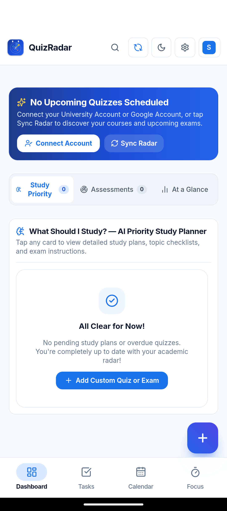
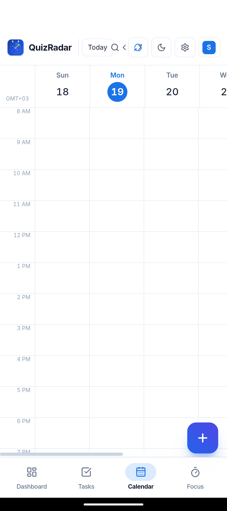
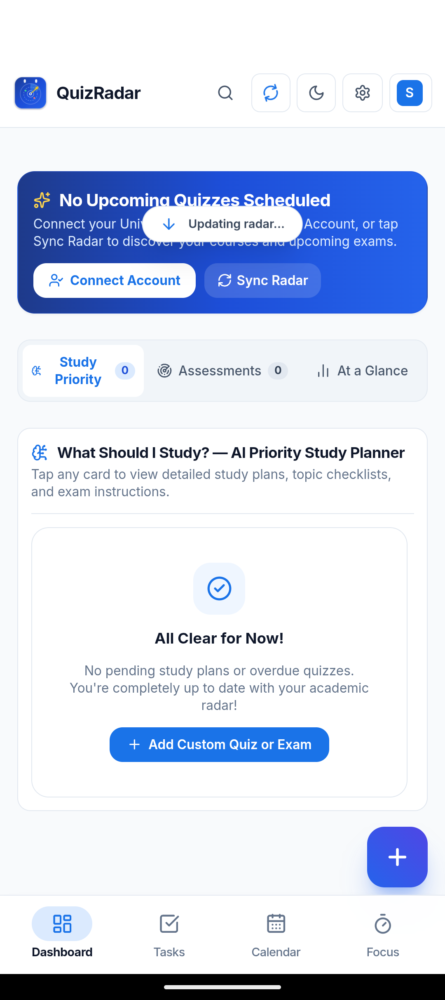
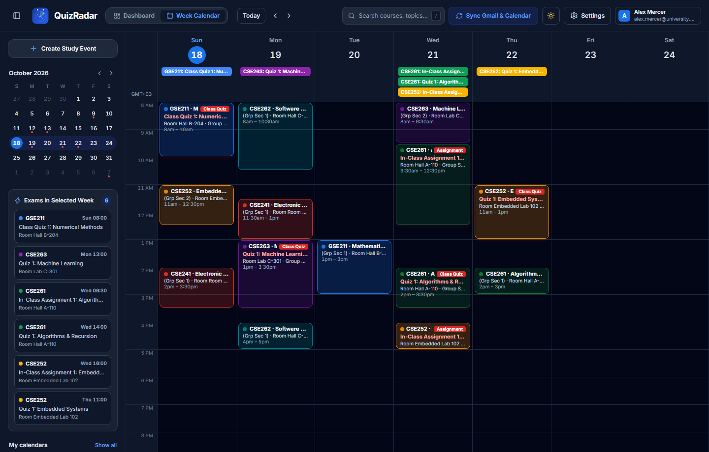

<div align="center">


# QuizRadar v3.3.0

**Never miss a quiz, lab assessment, or midterm buried in your university inbox, Microsoft Teams, Moodle, or Google Classroom.**

[](https://github.com/TheDragonSoft/QuizRadar/releases/latest)
[](https://github.com/TheDragonSoft/QuizRadar/releases/latest)
[](https://thedragonsoft.github.io/QuizRadar/)
[](#-your-data-stays-100-local)
[](#-features--parity)

<p align="center">
  <a href="https://thedragonsoft.github.io/QuizRadar/"><strong>🌐 Open Web App (iPhone / PWA)</strong></a> ·
  <a href="https://github.com/TheDragonSoft/QuizRadar/releases/latest"><strong>⬇ Download Native App (v3.3.0)</strong></a> ·
  <a href="#-android-mobile-app"><strong>📱 Android App</strong></a> ·
  <a href="#-features--parity"><strong>✨ Features & Parity</strong></a> ·
  <a href="#-visual-tour--screenshots"><strong>📸 Screenshots</strong></a> ·
  <a href="#-quick-start"><strong>🚀 Quick Start</strong></a>
</p>

</div>

---

## 🎯 Overview

Professors and academic portals rarely give you an exact calendar date when announcing a quiz or assignment. Instead, you get announcements like:

> *"Dear Students, you will have Class Quiz 1 during your scheduled lecture next week (not this week). Bring a scientific calculator."*

Figuring out when that quiz actually happens means checking when the announcement was posted, cross-referencing your weekly lecture slot, finding the right hall/room number, and calculating the date by hand—across Gmail, Microsoft Teams, Moodle, and Google Classroom.

**QuizRadar** does that on **the desktop**, where your Google / Microsoft accounts are connected for real scanning, and **synchronizes the picture to your phone** via Desktop Pairing. Every date QuizRadar shows you comes from either your announcements, your weekly timetable, or is clearly labeled as an *estimate* — never silently invented.

---

## 📱 Android Mobile App

A native **Android Application** built for high performance, gestures, and offline independence:

- **On-Device Engine**: Runs 100% offline using local storage. Timetable, deadlines, tasks and progress stay on the phone.
- **Desktop Pairing (Optional)**: Connect to the QuizRadar desktop app on the same Wi-Fi (`quizradar.exe --lan`) to pull your scanned schedule & upcoming exams onto the phone.
- **Dynamic Date & Day-of-Week Synchronization**: Real-time relative countdowns (`Today`, `Tomorrow`, `In X days`) that automatically update with your device clock.
- **Native Touch & Gestures**: Smooth pull-to-refresh, swipe-to-scroll timetable, and tactile haptic feedback.
- **Accessible Light & Dark Theming**: Adaptive status bar and dynamic theme switching with Impeccable contrast standards.
- **Clean First-Run State**: Zero preloaded courses, no invented professors, no fake quizzes. A blank canvas with a guided 3-step wizard.

---

## ✨ Features & Parity

| Feature | Desktop (Rust + Axum) | Android Mobile (Capacitor) |
|---|:---:|:---:|
| **Gmail Announcement Scanning** (real OAuth) | ✅ | via Desktop Pairing |
| **Microsoft Teams / Moodle / Classroom Ingestion** | ✅ | via Desktop Pairing |
| **On-Device Engine & Manual Schedule Editing** | ✅ | ✅ |
| **Smart Academic Dashboard** with Urgent Deadlines | ✅ | ✅ |
| **"What Should I Study?" Priority Planner** | ✅ | ✅ |
| **7-Day Interactive Week Calendar** (8 AM – 8 PM) | ✅ | ✅ |
| **Dynamic Date Engine** (Real-time Countdowns) | ✅ | ✅ |
| **Pull-to-Refresh & Dedicated Sync Button** | ✅ | ✅ |
| **Exam Overload & Clash Detection Banner** | ✅ | ✅ |
| **1-Click Google Calendar Push & `.ics` Export** | ✅ | ✅ |
| **AI Study Planning & Practice Quizzes** (Gemini key, optional) | ✅ | on-device fallback |
| **Impeccable Light & Dark Mode** | ✅ | ✅ |
| **Zero Server Tracking / 100% Local Privacy** | ✅ | ✅ |

---

## 📸 Visual Tour & Screenshots

### 📱 Android Mobile App (New in v3.0.0)
<table>
  <thead>
    <tr>
      <th align="center">📊 Smart Academic Dashboard</th>
      <th align="center">🗓 7-Day Week Calendar</th>
      <th align="center">🔄 Native Pull-to-Refresh</th>
    </tr>
  </thead>
  <tbody>
    <tr>
      <td align="center">
        
      </td>
      <td align="center">
        
      </td>
      <td align="center">
        
      </td>
    </tr>
  </tbody>
</table>

### 💻 Desktop Workspace Views
<table>
  <thead>
    <tr>
      <th align="center">📊 Smart Academic Dashboard</th>
      <th align="center">🗓 7-Day Week Calendar</th>
    </tr>
  </thead>
  <tbody>
    <tr>
      <td align="center">
        <strong>☀️ Light Mode</strong><br />
        
      </td>
      <td align="center">
        <strong>☀️ Light Mode</strong><br />
        
      </td>
    </tr>
    <tr>
      <td align="center">
        <strong>🌙 Dark Mode</strong><br />
        
      </td>
      <td align="center">
        <strong>🌙 Dark Mode</strong><br />
        
      </td>
    </tr>
  </tbody>
</table>

---

## 🔒 Your Data Stays 100% Local

> [!IMPORTANT]
> **Zero Cloud Servers · Zero Tracking · Complete Local Ownership**
> QuizRadar stores your data strictly on your own hardware. OAuth tokens stay on the machine that created them; they are **never** transferred between paired devices.

- **Direct University API Connection**: Microsoft Teams, Google Classroom, and Gmail tokens remain stored on your local device.
- **Desktop Pairing Transfers Data, Not Credentials**: the Android client reads your timetable & exams from the desktop; tokens never leave the desktop.
- **Honest Estimates**: when the scanner cannot find an exact date it shows one you can verify, marked clearly as a heuristic estimate — with your Gemini API key, AI does the reading instead of heuristics.
- **Offline Ready**: Full timetable exploration, topic checklists, and calendar navigation function without internet access.

---

## 🚀 Quick Start

### 🍏 iPhone, iPad & Web App (PWA)
1. Open **[thedragonsoft.github.io/QuizRadar](https://thedragonsoft.github.io/QuizRadar/)** in Safari on your iPhone or iPad.
2. Tap the Safari **Share** button (the square with an arrow pointing up).
3. Tap **"Add to Home Screen"**.
4. QuizRadar is now installed on your home screen with its own app icon, launching full-screen with offline support!

### 📱 Android Mobile App
1. Download **`QuizRadar-v3.3.0-Android.apk`** from the **[Latest GitHub Release](https://github.com/TheDragonSoft/QuizRadar/releases/latest)**.
2. Install the APK on your Android device:
   ```powershell
   adb install -r QuizRadar-v3.3.0-Android.apk
   ```
3. Optional: pair it with the desktop app to pull your scanned schedule:
   ```text
   PC:      quizradar.exe --lan            → shows http://<your-ip>:5050
   Phone:   Desktop Engine screen → Pair With Desktop → enter that address → Pull Desktop Data
   ```
4. Or build directly from source:
   ```powershell
   npx cap sync android
   cd android
   $env:JAVA_HOME = "C:\Program Files\Java\jdk-21"
   ./gradlew.bat assembleDebug
   ```

### 💻 Desktop Applications

#### 🪟 Windows
1. Download **`QuizRadar-Setup-v3.3.0-x64.exe`** (or portable ZIP) from **[GitHub Releases](https://github.com/TheDragonSoft/QuizRadar/releases/latest)**.
2. Run the installer or extract the portable ZIP.

#### 🍎 macOS (Apple Silicon)
1. Download **`QuizRadar-v3.3.0-macos-arm64.dmg`** from **[GitHub Releases](https://github.com/TheDragonSoft/QuizRadar/releases/latest)**.
2. Open the disk image and drag **QuizRadar.app** to your `/Applications` folder.

#### 🐧 Linux (Debian / Ubuntu / Linux Mint)
1. Download **`QuizRadar-v3.3.0-linux-amd64.deb`** from **[GitHub Releases](https://github.com/TheDragonSoft/QuizRadar/releases/latest)**.
2. Install via package manager:
   ```bash
   sudo dpkg -i QuizRadar-v3.3.0-linux-amd64.deb
   ```

#### 🛠️ Build from Source
```powershell
cargo build --release
.\target\release\quizradar.exe
```

#### 🔐 Privacy Note on Binding
By default the desktop server binds to `127.0.0.1` (this computer only). Start with `--lan` if you want to pair your phone — otherwise nothing external can reach your dashboard.

---

<p align="center">Made with ❤️ for students everywhere.</p>
