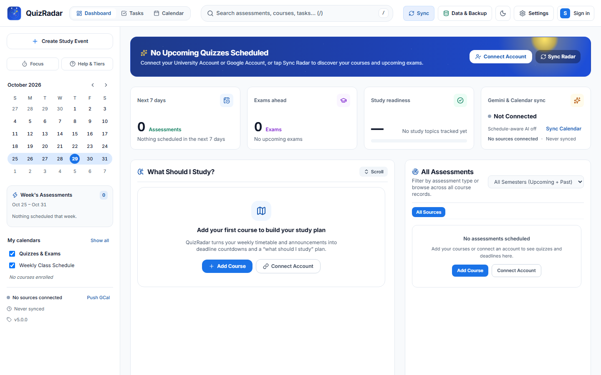
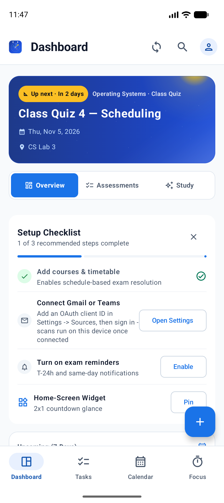
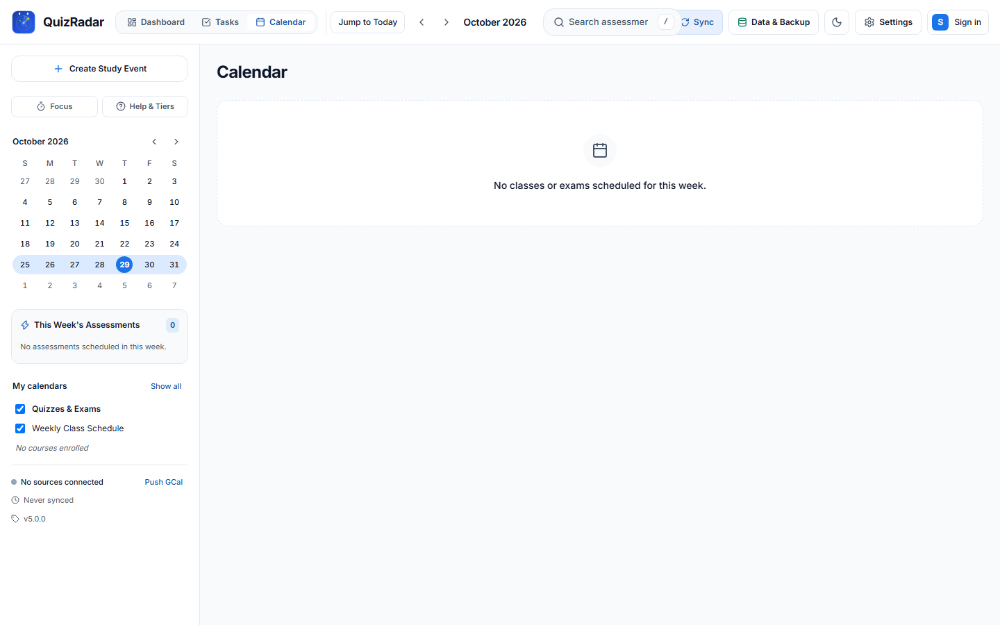
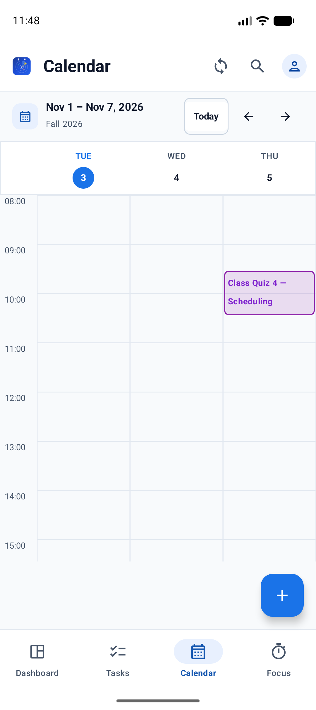
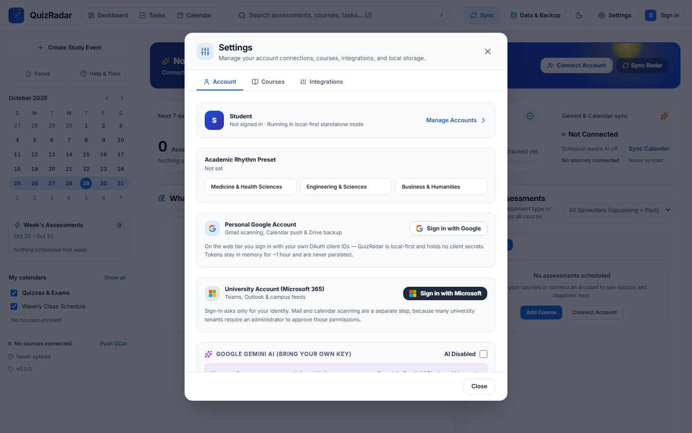
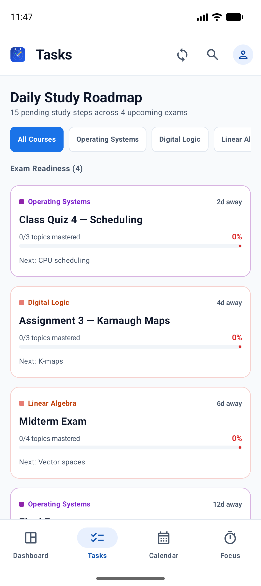
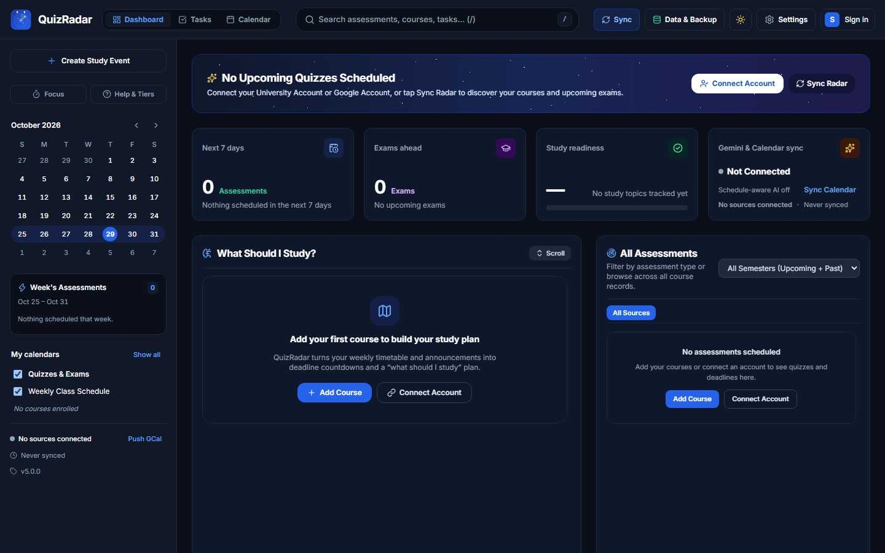
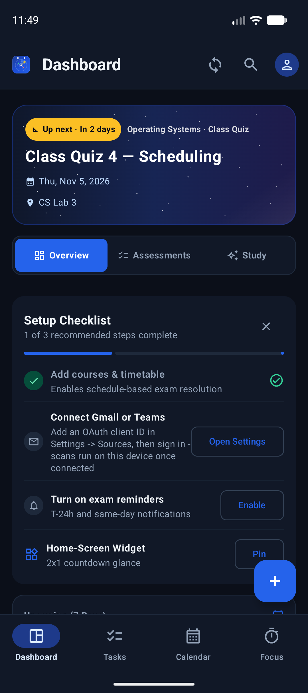
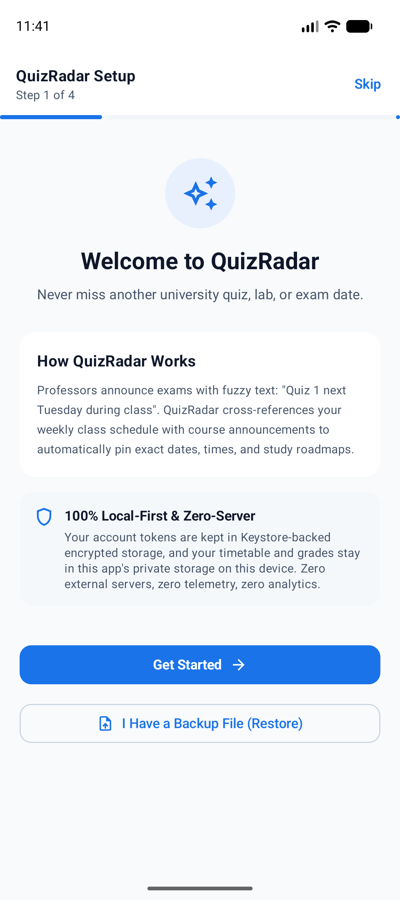
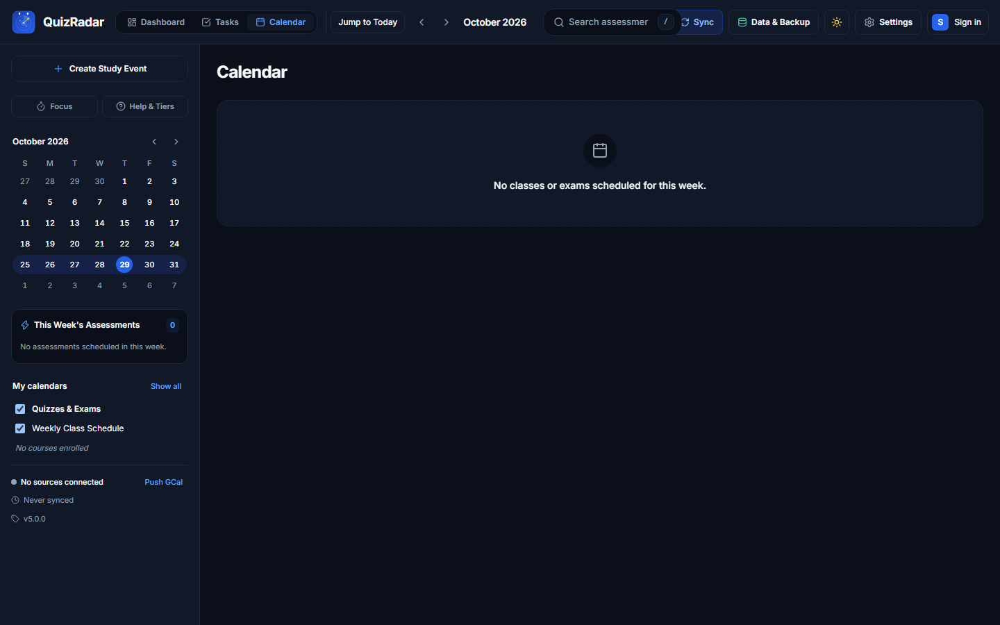

# QuizRadar

[](https://github.com/TheDragonSoft/QuizRadar/actions/workflows/ci.yml)
[](LICENSE)
[](docs/architecture-v5.md)
[](core/)
[](PRIVACY.md)

**QuizRadar** is a local-first, zero-server academic radar for university students. It resolves fuzzy announcements (_"Class Quiz 1 next week, not this week"_) into exact calendar items by cross-referencing each announcement against your weekly timetable, then manages the resulting exam radar — complete with conflict detection, readiness tracking, study recommendations, practice quizzes, grade what-if calculations, and home screen countdown widgets.

---

## 1. Install & Downloads

All official builds are published on the [GitHub Releases](https://github.com/TheDragonSoft/QuizRadar/releases) page and produced by signed CI builds (`SHA256SUMS.txt` verifies every artifact).

| Platform | Artifact | Notes |
| --- | --- | --- |
| **Windows** | `QuizRadar_5.0.0_x64-setup.exe` (NSIS) or `QuizRadar-Portable-win-x64.zip` | In-app auto-updater (minisign-signed `latest.json`) |
| **macOS** | `.dmg` (Apple Silicon) | |
| **Linux** | `.deb` / `.AppImage` (x64) | |
| **Android** | `QuizRadar-v5.0.0.apk` / `.aab` | arm64-v8a + x86_64; see **Android sign-in setup** below |
| **Web Companion (PWA)** | [thedragonsoft.github.io/QuizRadar](https://thedragonsoft.github.io/QuizRadar/) | Install from your browser ("Add to Home Screen"); runs fully offline after first visit |

### Android sign-in setup (bring your own OAuth client)

QuizRadar ships **no embedded Android OAuth client** — Android Google accounts require *your* Google Cloud OAuth client, because Google binds Android clients to a package name + signing certificate:

1. In [Google Cloud Console → Credentials](https://console.cloud.google.com/apis/credentials), create an **OAuth client ID** of type **Android** with package name `com.quizradar.app` and the SHA-1 of the certificate you installed the APK with.
2. Create a **Web application** client for Microsoft/Azure (or reuse one) and add the redirect `com.quizradar.app://oauth/microsoft`.
3. In QuizRadar → **Settings → Sources**, paste the Google client ID (and the Microsoft client ID) — sign-in then works, and Gmail/Classroom/Teams scans run on-device.

Without a client id the app refuses sign-in with an honest message instead of pretending to scan. The **desktop** tier ships its own configured Google client, so Windows/macOS/Linux need none of the above.

---

## 2. Screenshots

| Desktop (Windows / macOS / Linux) | Android |
| --- | --- |
|  |  |
|  |  |
|  |  |

<details>
<summary>More (dark mode, onboarding, focus timer)</summary>

| | |
| --- | --- |
|  |  |
|  |  |
|  |  |

</details>

---

## 3. Platform Matrix

| Platform                      | Tier      | Shell Architecture                          | Auth & Storage                                                        | Native Edge Features                                                                                            |
| ----------------------------- | --------- | ------------------------------------------- | --------------------------------------------------------------------- | --------------------------------------------------------------------------------------------------------------- |
| **Desktop** (Win, Mac, Linux) | Primary   | **Tauri 2** (In-Process IPC) + **React 19** | Loopback PKCE OAuth; OS Keyring (`keyring-rs`); SQLite                | Signed Auto-Updater (`tauri-plugin-updater`), native menus, system file dialogs                                 |
| **Android** (Phone & Tablet)  | Native    | **Kotlin 2.x** + **Jetpack Compose M3**     | Custom-scheme PKCE OAuth (BYO client id); `EncryptedSharedPreferences`; UniFFI SQLite | **On-device announcement scanning**, optional 6-hour background scan, Glance 2x1 AppWidget, T-24/digest notifications, `ACTION_SEND` share-sheet ingest, Google Calendar push, Drive backup |
| **Web Companion** (PWA)       | Companion | **React 19** + **WebAssembly Core**         | In-memory ephemeral GIS tokens (1-hour lifespan); IndexedDB SQLite    | Service Worker offline caching (engine + snapshot precached), responsive mobile & desktop web layouts           |

> **Note on PWA Limits:** The Web Companion PWA runs entirely in-browser without a backend server. It uses ephemeral 1-hour Google Identity Services tokens (no persistent refresh tokens), performs manual scans only, and pushes calendar data via `.ics` export instead of the Google Calendar API. For background scans and direct Calendar push, use the Desktop or Android app.

---

## 4. Core Capabilities

- **Fuzzy Announcement Resolution:** Automatically cross-references email and LMS announcements against your course schedule, anchoring phrases like _"next week"_ or _"the following Tuesday"_ to exact timetable lecture slots.
- **Multi-Source Ingestion:**
  - **Gmail:** Scans recent candidate announcements across 5 targeted queries with deduplication.
  - **Microsoft Teams:** Microsoft Graph client with heuristics for channel posts.
  - **Moodle LMS:** Connects via REST API token or private iCalendar (`.ics`) webcal links.
  - **Google Classroom:** Direct ingestion of active coursework and due dates.
- **Academic Dashboard & Conflict Radar:**
  - 7-day upcoming assessment KPIs and exam-type breakdown pills.
  - Overall exam readiness score dynamically calculated from syllabus topics.
  - Automatic conflict detection with instant scheduling of dedicated study blocks.
- **What Should I Study?** Prioritized study recommendations with optimistic topic completion checkoffs.
- **Interactive Calendar & Roadmap:**
  - 7-day (Desktop) and 3-day (Mobile) overlapping lane timetable views with visual exam glow.
  - Daily study roadmap and per-course readiness grid.
  - One-click iCalendar (`.ics`) file export and one-way Google Calendar push (dated assessments — never an import of your calendar).
- **Grades & What-If Projection:** Record achieved scores and simulate required finals scores to achieve your target letter grades.
- **Study Support Tools:**
  - AI-assisted practice quiz generator with labeled on-device deterministic fallbacks.
  - Integrated Pomodoro focus timer with audio completion chimes and topic completion links.
- **v4 Data Migration:** One-click import tool restoring courses, assessments, grades, and topic progress from legacy QuizRadar v4 backup files.

---

## 5. Privacy & The Honesty Doctrine

QuizRadar is engineered with a strict **Honesty Doctrine**:

1. **Zero Server Architecture:** QuizRadar operates no servers, relays, or central databases. All data remains on your physical device.
2. **Zero Fabricated Data:** If a room, instructor, or time is unannounced, QuizRadar renders `"—"` rather than hallucinating placeholder lecture halls.
3. **No Embedded Secrets:** Authentication uses standard PKCE OAuth 2.0 without embedded client secrets.
4. **Bring-Your-Own-Key (BYOK) AI:** Optional Google Gemini AI features use your personal API key via direct HTTP headers. When offline or unconfigured, QuizRadar automatically uses fully local, deterministic heuristics.

See [PRIVACY.md](PRIVACY.md) and [SECURITY.md](SECURITY.md) for full policies.

---

## 6. Development & Building from Source

### Prerequisites

- **Rust:** Stable toolchain (`rustup update stable`)
- **Node.js:** Node.js 20+ with `pnpm`
- **Java:** JDK 21 (Temurin / Adoptium) — Gradle 8.11 rejects Java 25, so point `JAVA_HOME` at the JDK 21 install
- **Android SDK:** Command-line Tools, API Platform 35, Build-Tools 34.0.0+, and the **NDK r27b** (`sdkmanager "ndk;27.1.12297006"`); the build locates it via `ANDROID_NDK_HOME` or the SDK's `ndk/` directory
- **wasm-bindgen-cli:** version pinned by `Cargo.lock` (only needed for the PWA tier: `pnpm --dir apps/web build:wasm`)

### Build Commands

```powershell
# 1. Install frontend dependencies
pnpm install

# 2. Run Rust Core tests
cargo test --workspace

# 3. Typecheck and lint Web UI
pnpm format:check
pnpm lint
pnpm typecheck
pnpm test

# 4. Run Android lint and unit tests
cd apps/mobile-android
.\gradlew.bat ktlintCheck testDebugUnitTest
```

---

## 7. Documentation

- [Architecture Specification (v5)](docs/architecture-v5.md)
- [Privacy Policy & AI Consent Disclosure](PRIVACY.md)
- [Security Policy & Vulnerability Reporting](SECURITY.md)
- [Contributing Guidelines](CONTRIBUTING.md)
- [License (MIT)](LICENSE)
