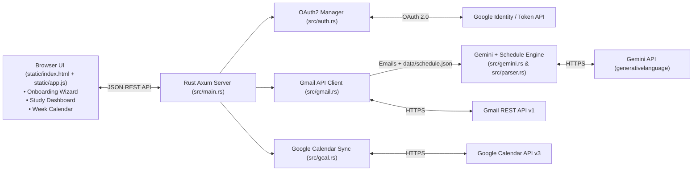

# 🎯 QuizRadar v2.0 — Standalone Rust Academic Dashboard, Weekly Calendar & Gemini AI Quiz Assistant

<p align="center">
  <b>A 100% native, standalone Rust desktop application with first-run Google Onboarding, Gemini AI schedule-aware email parsing, a prioritized Study Dashboard, a Google Calendar-style Week View, and automatic Google Calendar synchronization.</b>
</p>

---

## ✨ What's New in v2.0 (Complete Pure-Rust Rewrite)

1. **🦀 100% Pure Standalone Rust Application**:
   - Zero Python dependencies — OAuth 2.0 authentication, Gmail API v1 scanning, MIME email decoding, Gemini AI schedule reasoning, and Google Calendar API v3 synchronization all run natively inside the compiled Rust binary (`target/release/quizradar.exe`).
2. **🚀 Standalone First-Time Onboarding Wizard**:
   - Open `quizradar.exe` (or `start.bat`) after installation and walk through a 3-step onboarding wizard:
     - **Step 1**: 1-Click **Sign in with Google** (`Gmail Read` + `Google Calendar Events` + `Google Profile`).
     - **Step 2**: **Gemini AI Schedule-Aware Inbox Scan** that cross-references your university announcement emails with your weekly class timetable.
     - **Step 3**: Configure automatic Google Calendar synchronization and launch directly into your personalized dashboard.
3. **🧠 Gemini AI Schedule-Aware Email & Timetable Reasoning (`src/gemini.rs` + `src/parser.rs`)**:
   - University announcements often omit exact dates, times, or room numbers (e.g., *"Quiz next week (not this week) during your scheduled lecture"* or *"Quiz on Monday and Wednesday during lecture time at your assigned slot"*).
   - QuizRadar feeds both the **email's sent timestamp** and your **registered weekly schedule** ([data/schedule.json](file:///d:/Projects/QuizRadar/data/schedule.json)) into Gemini AI and its schedule inference engine to determine the exact `YYYY-MM-DD`, `start_time`, `end_time`, `room`, and `group`, displaying a transparent **"Gemini Schedule-Aware Time Inference"** explanation on every assessment card.
4. **📊 Smart Academic Dashboard ("What's Coming Next & What Should I Study?")**:
   - **"What's Coming Next" Hero Spotlight**: Live countdown to your immediate next quiz/exam with room, group, instructor, AI study focus, and critical warnings.
   - **4 Executive KPI Cards**:
     - *Coming Up This Week* count
     - *Types of Exams Breakdown* (`Class Quiz`, `Online Quiz`, `Midterm Exam`, `Final Exam`, `Lab Assessment`, `Assignment`)
     - *Study Readiness Score* (`%` of topics mastered across upcoming exams)
     - *Gemini & Google Calendar Sync Status*
   - **"What Should I Study?" AI Priority Study Planner**:
     - Ranks upcoming exams by a composite **Priority Score (`0–100`)** based on days remaining, assessment weight, and topic count.
     - Interactive **Topic Checklists** persisted locally ([data/app_config.json](file:///d:/Projects/QuizRadar/data/app_config.json)) so you can check off lecture topics and tutorial sheets as you study.
     - Highlights **Critical Exam Warnings** (e.g., *"⚠️ Bring your printed Quiz Template"*, *"⚠️ Strict Navigation: Cannot go back to previous questions"*).
5. **📅 Google Calendar-Style Weekly Calendar View**:
   - Clean 7-day Week Grid (`SUN` – `SAT`, `8 AM` – `8 PM`) modeled after Google Calendar.
   - Displays your recurring weekly classes alongside glowing **`⚡ QUIZ`** badges on the exact lecture/tutorial slots where an exam is scheduled in that week.
   - Interactive **Mini Month Calendar** in the left sidebar with week-pill highlighting, a **"Exams in Selected Week"** radar summary box, **"My calendars"** course & layer filters, and a **`+ Create`** button to add custom study sessions or quizzes.
6. **🔄 Automatic Google Calendar Synchronization (`src/gcal.rs`)**:
   - Automatically pushes and updates upcoming quizzes and exams directly to your signed-in Google Calendar via the Google Calendar v3 REST API (`POST / PUT /calendars/primary/events`), complete with study topics, warnings, room locations, and popup reminders (24 hours & 2 hours prior), plus 1-click `.ics` export.

---

## 🏗️ System Architecture



For deep module-by-module documentation, see [docs/ARCHITECTURE.md](file:///d:/Projects/QuizRadar/docs/ARCHITECTURE.md).

---

## 📚 Enrolled Courses & Active Exam Radar (Fall 2026)

| Course ID | Course Name | Weekly Schedule Slots | Active Upcoming Assessment |
| :--- | :--- | :--- | :--- |
| **GSE211** | **Mathematical Analysis and Numerical Methods** | Sun 8:00–10:00 AM (Lec, C212 O), Tue 1:00–3:00 PM (Tut, G202 B) | **Class Quiz 1**: Sun, 18 Oct 2026 (8:00–10:00 AM, Room C212 O) |
| **CSE263** | **Machine Learning and Pattern Recognition** | Mon 1:00–3:30 PM (Lec, C203 O), Wed 8:00–9:30 AM (Lab, D203 O) | **Quiz 1**: Mon, 19 Oct 2026 (1:00–3:30 PM, Room C203 O) |
| **CSE261** | **Algorithms and Data Structures** *(Moodle CSE354)* | Wed 9:30 AM–12:30 PM (Lab), Wed 2:00–3:30 PM (Lec, D114 O), Thu 2:00–3:00 PM (Tut) | **Quiz 1**: Wed, 21 Oct 2026 (2:00–3:30 PM, Room D114 O) |
| **CSE252** | **Embedded Systems Design** | Sun 11:00 AM–12:30 PM (Lab), Wed 4:00–5:00 PM (Tut), Thu 11:00 AM–1:00 PM (Lec, L102 O) | **Quiz 1**: Thu, 22 Oct 2026 (11:00 AM–1:00 PM, Room L102 O) |
| **CSE241** | **Electronic Design Automation** | Sun 2:00–3:30 PM (Lab, D202 O), Mon 11:30 AM–1:00 PM (Lec, L102 O) | **Class Quiz 1**: Completed Mon, 12 Oct 2026 |
| **CSE262** | **Software Engineering** | Mon 8:00–10:30 AM (Lec, D113 O), Mon 4:00–5:00 PM (Tut, D322 B) | **Midterm Exam**: Sat, 7 Nov 2026 |

---

## 🛠️ Quick Start & Running Standalone

### Option 1: Instant Launch (Windows Pre-Built Binary)
Double-click **[start.bat](file:///d:/Projects/QuizRadar/start.bat)** or run the compiled executable directly:
```powershell
.\target\release\quizradar.exe
```
The application will start on `http://127.0.0.1:5000` and automatically open in your default browser.

### Option 2: Build from Source with Cargo
```powershell
cargo run --release
```

---

## 🔌 REST API Endpoints ([src/main.rs](file:///d:/Projects/QuizRadar/src/main.rs))

| Method | Endpoint | Description |
| :--- | :--- | :--- |
| `GET` | `/api/state` | Returns complete unified state (`config`, `auth`, `schedule`, `assessments`, `dashboard`) |
| `GET` | `/api/auth/google/login` | Initiates Google OAuth 2.0 flow (`gmail.readonly`, `calendar.events`, `userinfo`) |
| `GET` | `/api/auth/callback` | OAuth 2.0 redirect callback; exchanges code, saves `token.json`, and runs initial sync |
| `POST` | `/api/onboarding/complete` | Saves standalone onboarding preferences and runs full sync |
| `POST` | `/api/sync` | Fetches latest Gmail announcements, runs Gemini schedule inference, and syncs to Google Calendar |
| `POST` | `/api/gcal/sync` | Explicitly pushes/updates all upcoming assessments to the signed-in Google Calendar |
| `POST` | `/api/study/toggle` | Checks or unchecks a study topic item and recalculates study readiness percentage |
| `POST` | `/api/events/custom` | Adds a custom study session or custom quiz to the Weekly Calendar |
| `DELETE` | `/api/events/custom/:id` | Removes a custom event from the Weekly Calendar |
| `GET` | `/api/calendar/ics/:id` | Downloads an RFC 5545 `.ics` file for a single assessment with exact start/end times |
| `GET` | `/api/calendar/ics_all` | Downloads an RFC 5545 `.ics` calendar bundle containing all upcoming assessments |
