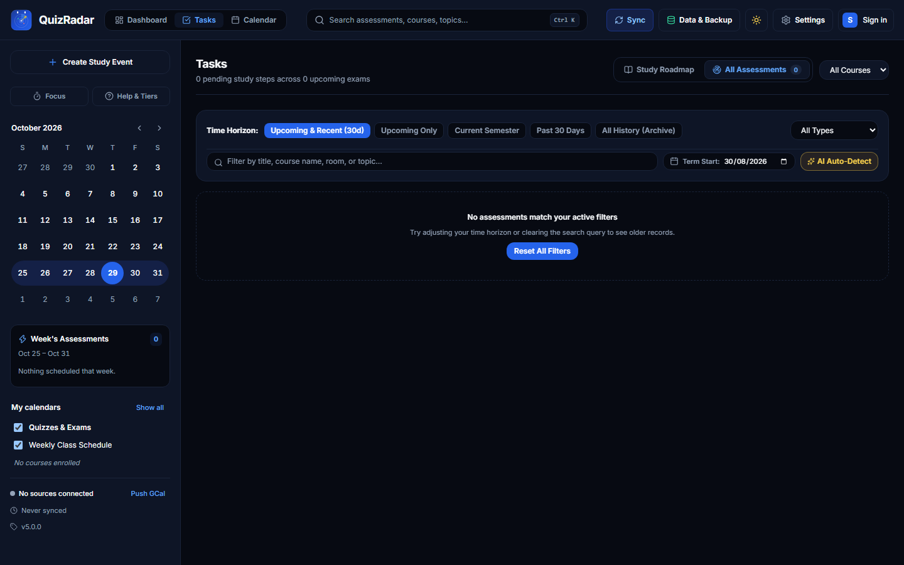
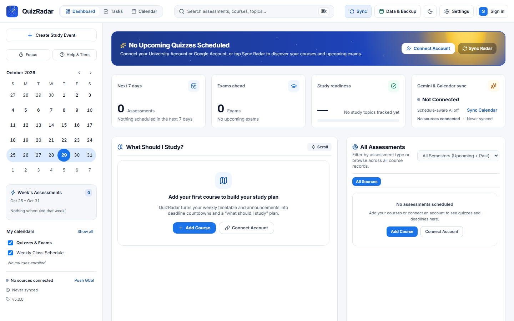
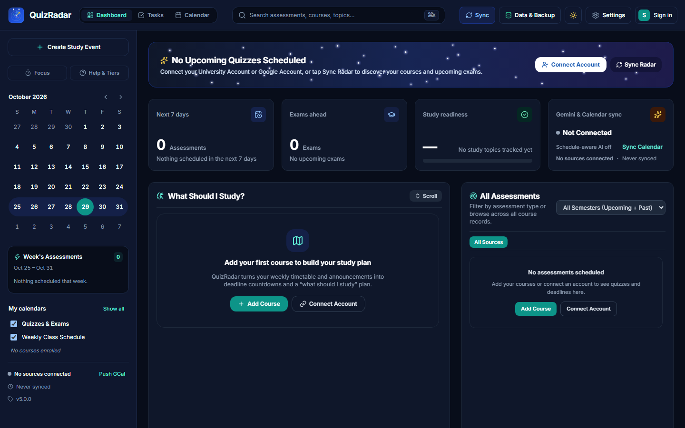

# QuizRadar

<p align="center">
  
</p>

<p align="center">
  <b>Turn chaotic university class announcements into a calm semester schedule.</b><br/>
  A local-first, zero-server academic radar for university students.
</p>

<p align="center">
  <a href="https://thedragonsoft.github.io/QuizRadar/"><strong>🌐 Official Website</strong></a> •
  <a href="https://thedragonsoft.github.io/QuizRadar/app/"><strong>📱 Launch Web Companion (PWA)</strong></a> •
  <a href="https://thedragonsoft.github.io/QuizRadar/download/"><strong>📦 Download Center</strong></a> •
  <a href="https://github.com/TheDragonSoft/QuizRadar/releases/latest"><strong>🚀 Latest Release</strong></a>
</p>

<p align="center">
  <a href="https://github.com/TheDragonSoft/QuizRadar/actions/workflows/ci.yml"></a>
  <a href="LICENSE"></a>
  <a href="docs/architecture-v5.md"></a>
  <a href="core/"></a>
  <a href="PRIVACY.md"></a>
</p>

---

## 1. What is QuizRadar?

**QuizRadar** is a private, on-device academic radar built for university students. Every semester, students navigate disorganized communication streams: professor emails, LMS posts, Teams chat messages, and PDF lecture slides. Announcements arrive with ambiguous date phrases like _"Class Quiz 1 next Tuesday, not this week"_, causing missed deadlines and exam scheduling panic.

QuizRadar solves this entirely on your device:

1. **Fuzzy Anchor Engine:** Scans course updates and resolves ambiguous natural language dates into exact timetable lecture and tutorial slots.
2. **Academic Conflict Radar:** Flags overlapping deadlines, exam pileups, and heavy assessment weeks ahead of time.
3. **Study Recommendations & Readiness Score:** Computes real-time preparation readiness per course, recommending focused study topics and practice quizzes.
4. **Zero Server Architecture:** All parsing, OAuth token management, and timetable storage remain strictly on your physical machine. No central server, no telemetry surveillance, and zero cloud lock-in.

---

## 2. Live Web & Downloads

| Platform                   | Channel / Artifact                                                                       | Architecture & Notes                                                   |
| :------------------------- | :--------------------------------------------------------------------------------------- | :--------------------------------------------------------------------- |
| **🌐 Official Website**    | [thedragonsoft.github.io/QuizRadar](https://thedragonsoft.github.io/QuizRadar/)          | Product tour, feature guides, download links, and FAQ                  |
| **📱 Web Companion (PWA)** | [thedragonsoft.github.io/QuizRadar/app/](https://thedragonsoft.github.io/QuizRadar/app/) | Zero-install offline web app; runs directly in browser via WebAssembly |
| **🪟 Windows**             | `QuizRadar_x64-setup.exe` / `Portable-win-x64.zip`                                       | Minisign-signed in-app auto-updater (`tauri-plugin-updater`)           |
| **🍏 macOS**               | `.dmg` / `.tar.gz`                                                                       | Apple Silicon & Intel universal packages                               |
| **🐧 Linux**               | `.deb` / `.AppImage`                                                                     | x86_64 native packages                                                 |
| **🤖 Android**             | `.apk` / `.aab`                                                                          | Native Kotlin & Jetpack Compose (arm64-v8a, x86_64)                    |

> 📦 **All binary downloads and signed checksums (`SHA256SUMS.txt`) are available on the [GitHub Releases](https://github.com/TheDragonSoft/QuizRadar/releases) page.**

### Android Sign-In Setup

- **Google Sign-In:** Works out of the box with QuizRadar's built-in OAuth credentials.
- **Microsoft Teams:** Microsoft requires your own Azure Client ID for custom redirect URI handling (`com.quizradar.app://oauth/microsoft`). You can register a free client ID in Azure Portal and paste it in `Settings → Integrations`.
- **Desktop & Web:** Desktop tiers ship their own loopback PKCE clients, requiring zero manual configuration.

---

## 3. Visual Showcase

### Desktop & Mobile Dashboard

|              Desktop Experience (Tauri 2 + React 19)               |             Android Native (Jetpack Compose M3)              |
| :----------------------------------------------------------------: | :----------------------------------------------------------: |
|  |  |

### Timetable & Academic Calendar

|                       Weekly Schedule View (Desktop)                       |              Schedule & Assessment Lanes (Android)              |
| :------------------------------------------------------------------------: | :-------------------------------------------------------------: |
|  |  |

### Assessment Hub & Study Tasks

|                          Assessment Radar & Tasks (Desktop)                           |         Study Roadmap & Topic Checklist (Android)          |
| :-----------------------------------------------------------------------------------: | :--------------------------------------------------------: |
|  |  |

<details>
<summary><b>🎨 Click to expand additional themes (Dark, Solar, Aurora, AMOLED, Focus Timer)</b></summary>

<br/>

|                         Obsidian / Night Skies                         |                           Pure AMOLED Minimal                            |
| :--------------------------------------------------------------------: | :----------------------------------------------------------------------: |
|  |  |

|                            Solar Golden Hour Theme                            |                            Aurora Borealis Gradient                             |
| :---------------------------------------------------------------------------: | :-----------------------------------------------------------------------------: |
|  |  |

|                 Pomodoro Focus Timer                 |                 Settings & Integration Hub                 |
| :--------------------------------------------------: | :--------------------------------------------------------: |
|  |  |

</details>

---

## 4. Platform Matrix

| Platform                      | Tier      | Shell Architecture                      | Auth & Storage                                                        | Native Features                                                                                                                           |
| :---------------------------- | :-------- | :-------------------------------------- | :-------------------------------------------------------------------- | :---------------------------------------------------------------------------------------------------------------------------------------- |
| **Desktop** (Win, Mac, Linux) | Primary   | **Tauri 2** + **React 19**              | Loopback PKCE OAuth; OS Keyring (`keyring-rs`); SQLite                | Signed Auto-Updater (`tauri-plugin-updater`), native menus, system file dialogs                                                           |
| **Android** (Phone & Tablet)  | Native    | **Kotlin 2.x** + **Jetpack Compose M3** | Custom-scheme PKCE OAuth; `EncryptedSharedPreferences`; UniFFI SQLite | **On-device announcement scanning**, optional background scan, Glance 2x1 AppWidget, T-24 notifications, Share-sheet ingest, Drive backup |
| **Web Companion** (PWA)       | Companion | **React 19** + **WebAssembly Core**     | Ephemeral GIS tokens; IndexedDB SQLite                                | Service Worker offline caching (engine precached), responsive mobile & desktop web layouts                                                |

---

## 5. Core Capabilities

- **Fuzzy Announcement Resolution:** Automatically cross-references announcement dates against your weekly timetable, anchoring phrases like _"next week"_ or _\"the following Tuesday\"_ to exact course lecture slots.
- **Multi-Source Ingestion:**
  - **Gmail:** Scans candidate class announcements across targeted queries with intelligent deduplication.
  - **Microsoft Teams:** Microsoft Graph client with heuristics for channel posts.
  - **Moodle LMS:** Connects via REST API token or private iCalendar (`.ics`) webcal subscriptions.
  - **Google Classroom:** Direct ingestion of active coursework, due dates, and classroom announcements.
- **Academic Dashboard & Conflict Radar:**
  - 7-day upcoming assessment KPIs and exam-type breakdown pills.
  - Overall exam readiness score dynamically calculated from syllabus topics.
  - Automatic conflict detection with instant scheduling of dedicated study blocks.
- **What Should I Study?** Prioritized study recommendations with optimistic topic completion checkoffs.
- **Grades & What-If Projection:** Record achieved scores and simulate required finals scores to achieve your target letter grades.
- **Study Support Tools:**
  - AI-assisted practice quiz generator with labeled on-device deterministic fallbacks.
  - Integrated Pomodoro focus timer with audio completion chimes and topic completion links.
- **Data Portability:** One-click JSON backup, restore, and v4 migration.

---

## 6. Privacy & The Honesty Doctrine

QuizRadar is engineered with a strict **Honesty Doctrine**:

1. **Zero Server Architecture:** QuizRadar operates no servers, relays, or central databases. All data remains on your physical device.
2. **Zero Fabricated Data:** If a room, instructor, or time is unannounced, QuizRadar renders `"—"` rather than hallucinating placeholder lecture halls.
3. **No Embedded Secrets:** Authentication uses standard PKCE OAuth 2.0 without embedded client secrets.
4. **Bring-Your-Own-Key (BYOK) AI:** Optional Google Gemini AI features use your personal API key via direct HTTP headers. When offline or unconfigured, QuizRadar automatically uses fully local, deterministic heuristics.

See [PRIVACY.md](PRIVACY.md) and [SECURITY.md](SECURITY.md) for full policies.

---

## 7. Development & Building from Source

### Prerequisites

- **Rust:** Stable toolchain (`rustup update stable`)
- **Node.js:** Node.js 20+ with `pnpm`
- **Java:** JDK 21 (Temurin / Adoptium)
- **Android SDK:** Command-line Tools, API Platform 35, Build-Tools 34.0.0+, and NDK r27b

### Build Commands

```powershell
# 1. Install workspace dependencies
pnpm install

# 2. Run Rust Core test suite
cargo test --workspace

# 3. Typecheck and lint Web UI
pnpm format:check
pnpm lint
pnpm typecheck
pnpm test

# 4. Run Android lint and unit tests
cd apps/mobile-android
.\gradlew.bat ktlintCheck testDebugUnitTest
```

---

## 8. Documentation

- [Official Landing Website](https://thedragonsoft.github.io/QuizRadar/)
- [Web Companion PWA](https://thedragonsoft.github.io/QuizRadar/app/)
- [Architecture Specification (v5)](docs/architecture-v5.md)
- [Privacy Policy & AI Consent Disclosure](PRIVACY.md)
- [Security Policy & Vulnerability Reporting](SECURITY.md)
- [Changelog](CHANGELOG.md)
- [License (MIT)](LICENSE)
