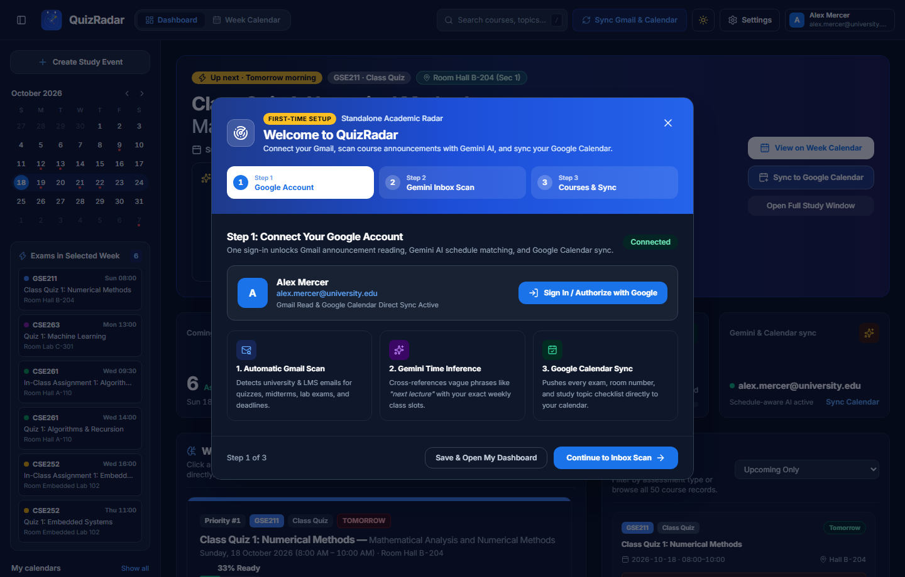
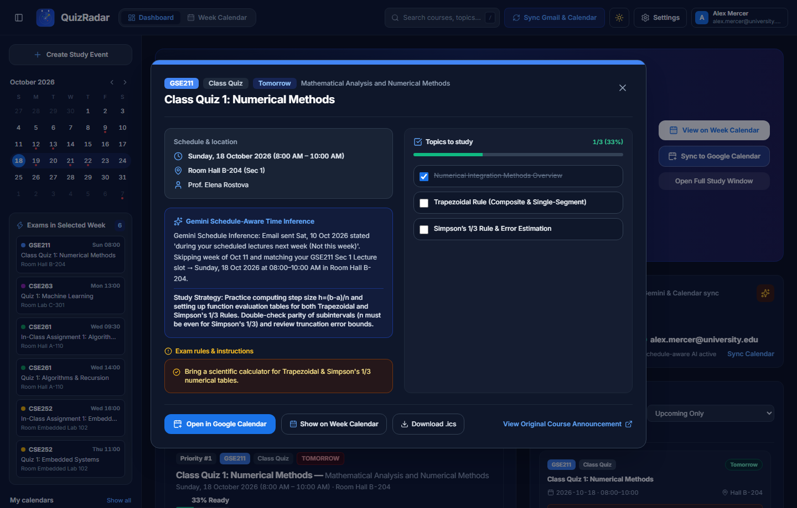
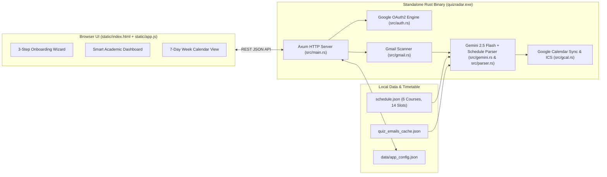

<div align="center">


# QuizRadar

**Never miss a quiz, lab assessment, or midterm buried in your university inbox.**

[](https://github.com/TheDragonSoft/QuizRadar/releases/latest)
[](Cargo.toml)
[](src/gemini.rs)
[](src/gcal.rs)

<p align="center">
  <a href="https://github.com/TheDragonSoft/QuizRadar/releases/latest"><strong>⬇ Download Standalone Release (v2.0.0)</strong></a> ·
  <a href="#-visual-tour--screenshots"><strong>📸 Screenshots</strong></a> ·
  <a href="#-key-features"><strong>✨ Features</strong></a> ·
  <a href="#-quick-start"><strong>🚀 Quick Start</strong></a> ·
  <a href="docs/ARCHITECTURE.md"><strong>📖 Technical Docs</strong></a>
</p>

</div>

---

## 🎯 Overview

Professors and course portals rarely give you an exact calendar date when announcing a quiz or assignment. Instead, you get emails like:

> *"Dear Students, you will have Class Quiz 1 during your scheduled lecture next week (not this week). Bring a scientific calculator."*

Figuring out when that quiz actually happens means checking when the email was sent, looking up your weekly lecture slot, finding the right room number, and adding it to your calendar by hand—for every single course.

**QuizRadar** does all of that for you automatically. It is a personal academic companion that connects your university inbox, your weekly class schedule, and your calendar into one clean workspace:

- **Finds Every Announced Exam Automatically**: Scans your Gmail for course announcements, quizzes, lab tests, assignments, and midterms so nothing slips through the cracks.
- **Turns Vague Emails into Exact Dates & Rooms**: Understands phrases like *"next week's lecture"* or *"during your assigned lab"* by matching each email against your actual weekly class timetable—giving you the exact date, time, and room number.
- **Tells You What to Study Right Now**: Breaks every upcoming exam into an interactive topic checklist, highlights important exam rules (like bringing a calculator or printed template), and tracks your overall study readiness.
- **Keeps Your Calendar in Sync**: Pushes your upcoming quizzes and study checklists straight to Google Calendar and gives you a built-in **7-Day Week Calendar** showing your classes and exams side by side.

---

## 📸 Visual Tour & Screenshots

### Workspace Views — Dashboard & 7-Day Week Calendar
<table>
  <thead>
    <tr>
      <th align="center">📊 Smart Academic Dashboard</th>
      <th align="center">🗓 7-Day Week Calendar</th>
    </tr>
  </thead>
  <tbody>
    <tr>
      <td align="center">
        <strong>☀️ Light Mode</strong><br />
        
      </td>
      <td align="center">
        <strong>☀️ Light Mode</strong><br />
        
      </td>
    </tr>
    <tr>
      <td align="center">
        <strong>🌙 Dark Mode</strong><br />
        
      </td>
      <td align="center">
        <strong>🌙 Dark Mode</strong><br />
        
      </td>
    </tr>
  </tbody>
</table>

### Guided First-Time Setup & Full Study Window
<table>
  <thead>
    <tr>
      <th align="center">🪄 First-Time Setup Wizard</th>
      <th align="center">📝 Assessment & Study Checklist Window</th>
    </tr>
  </thead>
  <tbody>
    <tr>
      <td align="center">
        <strong>☀️ Light Mode</strong><br />
        
      </td>
      <td align="center">
        <strong>☀️ Light Mode</strong><br />
        
      </td>
    </tr>
    <tr>
      <td align="center">
        <strong>🌙 Dark Mode</strong><br />
        
      </td>
      <td align="center">
        <strong>🌙 Dark Mode</strong><br />
        
      </td>
    </tr>
  </tbody>
</table>

---

## ✨ Key Features

| Feature | What It Does For You |
| :--- | :--- |
| **🪄 One-Time Guided Setup & Settings** | Get started in under a minute with a 3-step first-time setup wizard, and update your account, courses, theme, or sync preferences anytime in **Settings**. |
| **🧠 Schedule-Aware Date Matching** | Reads announcements in context with your weekly timetable so *"next week's lecture"* automatically becomes the exact day, time, and room for your section. |
| **📊 What Should I Study? Planner** | Ranks your upcoming exams by urgency, extracts the exact topics and lecture slides you need to review, and updates your readiness bar as you check topics off. |
| **⚠️ Per-Exam Rules & Reminders** | Surfaces critical instructions right on each quiz card—such as *"Bring a scientific calculator"*, *"Print the quiz template"*, or *"15-minute time limit"*. |
| **🗓 Interactive Week Calendar** | Displays your recurring weekly classes and upcoming exams on a unified `8 AM – 8 PM` calendar grid, with a **Create Study Event** button to block out study time. |
| **🔄 Automatic Google Calendar Sync** | Sends your quizzes, room numbers, and study checklists directly to Google Calendar (or exports them as a `.ics` calendar file) so your phone and laptop stay updated. |

---

## 🏗 System Architecture



---

## 🚀 Quick Start

### Option 1: Download the Standalone Release Build (Recommended)
1. Download **`QuizRadar-v2.0.0-windows-x64.zip`** (or `quizradar.exe`) from the **[Latest GitHub Release](https://github.com/TheDragonSoft/QuizRadar/releases/latest)**.
2. Extract the archive and double-click **`quizradar.exe`** (or run `start.bat`).
3. Your default browser will automatically open **`http://127.0.0.1:5000`** (or `5050`) and launch the **First-Time Onboarding Wizard**.

### Option 2: Build from Source with Cargo
```powershell
git clone https://github.com/TheDragonSoft/QuizRadar.git
cd QuizRadar
cargo build --release
.\target\release\quizradar.exe
```

### Optional: Custom Google Cloud OAuth2 Client (`credentials.json`)
To use your own Google Cloud OAuth2 Desktop/Web client for live Gmail & Google Calendar API writes:
1. Create an OAuth 2.0 Client ID in the [Google Cloud Console](https://console.cloud.google.com/apis/credentials) with **Gmail API** (`gmail.readonly`) and **Google Calendar API** (`calendar.events`) enabled.
2. Add `http://localhost:5000/api/auth/callback` and `http://localhost:5050/api/auth/callback` as Authorized Redirect URIs.
3. Save the downloaded JSON file as `credentials.json` in the project root (automatically ignored by `.gitignore`).

---

## 🔌 REST API Endpoints

| Method | Endpoint | Purpose |
| :--- | :--- | :--- |
| `GET` | `/api/state` | Returns full application state (`config`, `auth`, `schedule`, `assessments`, `dashboard`) |
| `GET` | `/api/auth/google/login` | Initiates Google OAuth2 flow (`gmail.readonly` + `calendar.events`) |
| `GET` | `/api/auth/callback` | Exchanges OAuth2 authorization code, saves `token.json`, and runs initial sync |
| `POST` | `/api/onboarding/complete` | Persists onboarding preferences and triggers background sync |
| `POST` | `/api/sync` | Scans Gmail messages, runs Gemini schedule inference, and syncs Google Calendar |
| `POST` | `/api/gcal/sync` | Pushes upcoming assessments directly to the signed-in Google Calendar |
| `POST` | `/api/study/toggle` | Persists study topic completion (`completed_topics`) and recalculates readiness |
| `POST` | `/api/events/custom` | Creates a custom study session or assessment on the Week Calendar |
| `DELETE` | `/api/events/custom/:id` | Removes a custom event from the Week Calendar |
| `GET` | `/api/calendar/ics/:id` | Downloads an RFC-5545 `.ics` file for a single assessment |
| `GET` | `/api/calendar/ics_all` | Downloads a combined `.ics` calendar feed of all upcoming assessments |

---

## 📂 Project Structure

```text
QuizRadar/
├── Cargo.toml                  # Rust crate manifest & dependencies
├── README.md                   # Repository homepage & visual documentation
├── schedule.json               # Fall 2026 weekly class schedule (6 courses, 14 slots)
├── quiz_emails_cache.json      # Cached university announcement emails
├── start.bat                   # One-click Windows launcher
├── docs/
│   ├── ARCHITECTURE.md         # Deep-dive system architecture & data flow guide
│   └── screenshots/            # High-resolution UI screenshots (Light, Dark, Calendar, Onboarding, Modal)
├── src/
│   ├── main.rs                 # Axum server, REST API routes & embedded asset fallbacks
│   ├── models.rs               # Strongly-typed data structures (Assessment, DashboardSummary, AppConfig)
│   ├── auth.rs                 # Google OAuth2 client & automatic token refresh
│   ├── gmail.rs                # Gmail REST API scanner + offline cache fallback
│   ├── gemini.rs               # Gemini 2.5 Flash schedule-aware prompt & JSON extractor
│   ├── parser.rs               # Timetable cross-referencing, relative date resolver & study planner
│   └── gcal.rs                 # Google Calendar REST API sync + RFC-5545 .ics generator
└── static/
    ├── icon.svg                # Official QuizRadar vector application icon
    ├── index.html              # Responsive UI (Onboarding Wizard, Smart Dashboard, Week Calendar)
    └── app.js                  # Frontend state, optimistic UI updates & overlap-aware calendar engine
```
