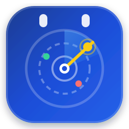
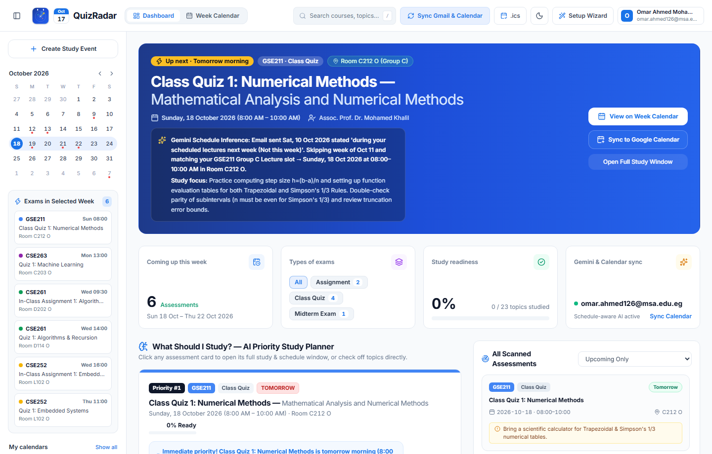
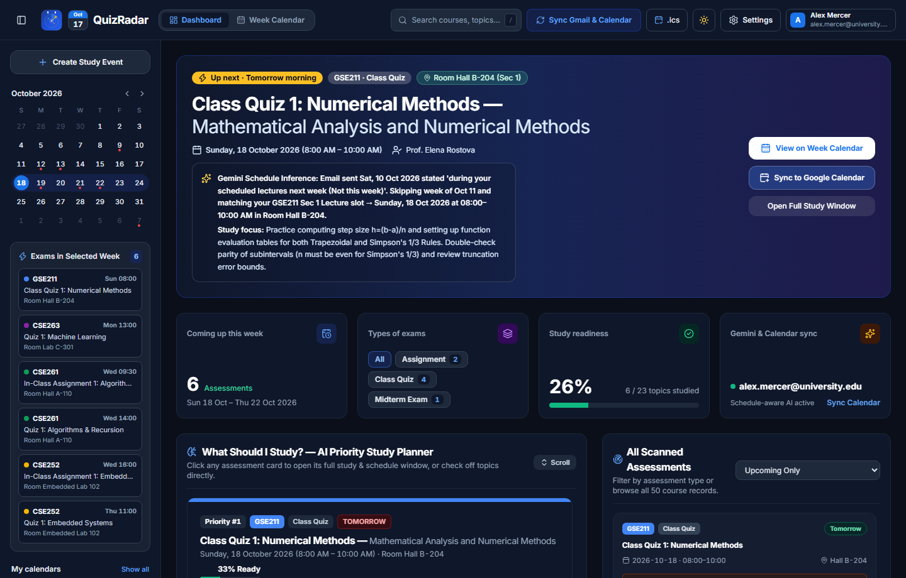
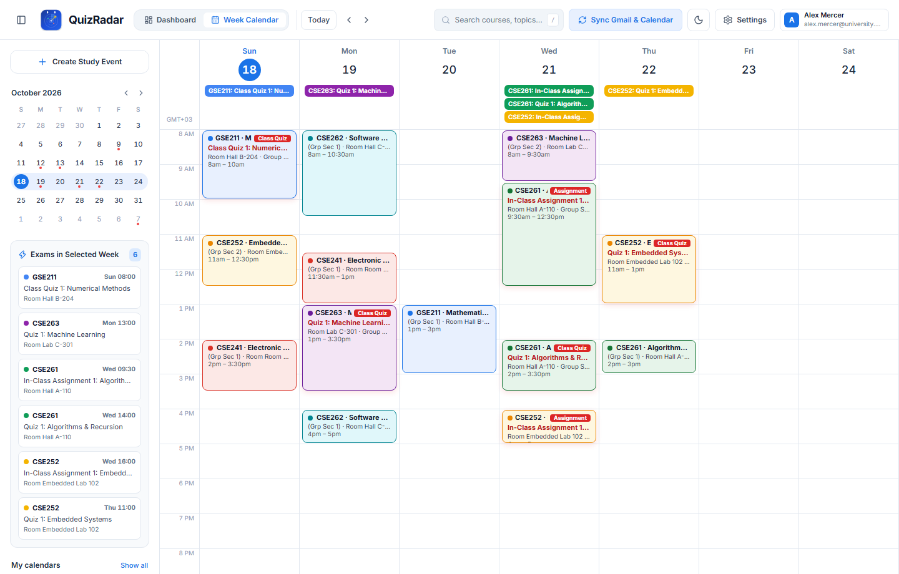
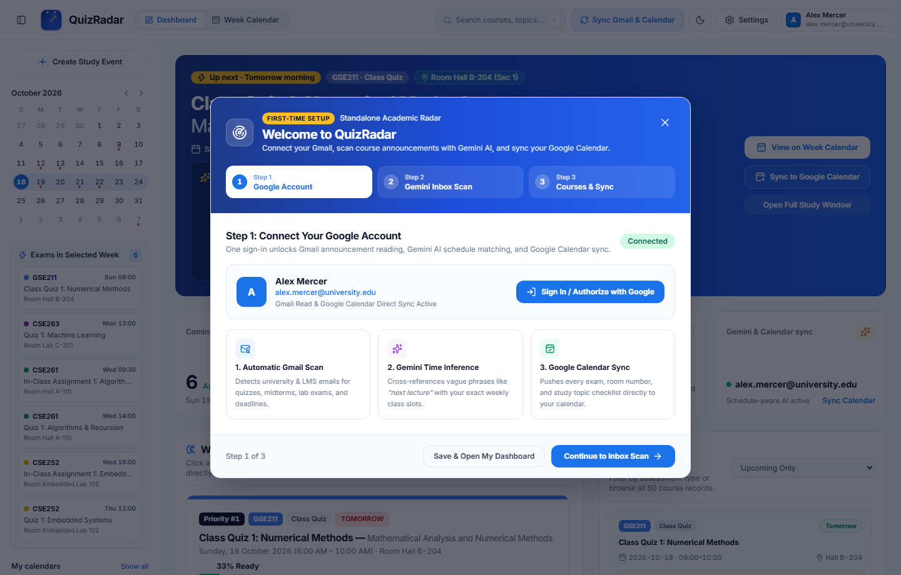
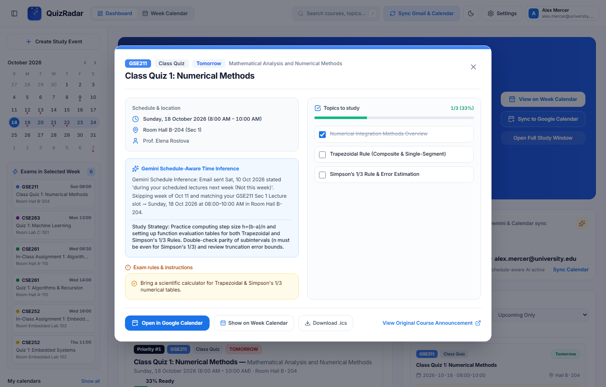
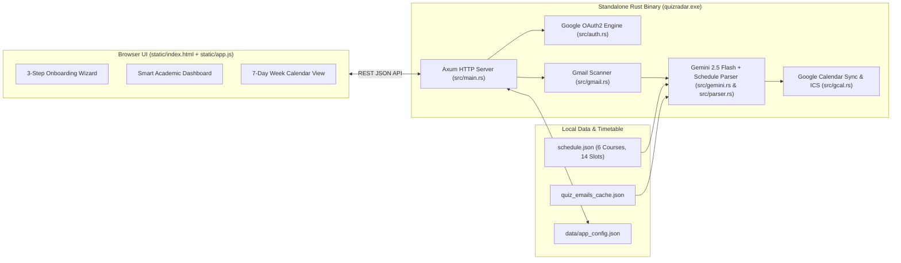

<div align="center">



# QuizRadar

**Standalone Rust Academic Dashboard, Gemini Schedule-Aware Email Scanner & Google Calendar Week View**

[](https://github.com/TheDragonSoft/QuizRadar/releases/latest)
[](Cargo.toml)
[](src/main.rs)
[](src/gemini.rs)
[](src/gcal.rs)

<p align="center">
  <a href="https://github.com/TheDragonSoft/QuizRadar/releases/latest"><strong>⬇ Download Standalone Release (v2.0.0)</strong></a> ·
  <a href="#-visual-tour--screenshots"><strong>📸 Screenshots</strong></a> ·
  <a href="#-key-features"><strong>✨ Features</strong></a> ·
  <a href="#-system-architecture"><strong>🏗 Architecture</strong></a> ·
  <a href="docs/ARCHITECTURE.md"><strong>📖 Technical Docs</strong></a>
</p>

</div>

---

## 🎯 Overview

University course announcements and LMS emails rarely state the exact calendar timestamp of an upcoming quiz or exam—instead, they use relative phrases like:

> *"Dear Students, you will have Class Quiz 1 during your scheduled lecture next week (not this week). Bring a scientific calculator."*

**QuizRadar** solves this in a single standalone Rust executable (`quizradar.exe`). Sign in once with your Google account during the guided 3-step onboarding flow, and QuizRadar automatically:
1. **Scans your Gmail inbox** (`gmail.readonly`) for university and LMS announcements (course portals, department notices, and course codes).
2. **Cross-references email timestamps with your weekly class timetable** using **Gemini 2.5 Flash** (`src/gemini.rs`) + deterministic schedule resolution (`src/parser.rs`) to pinpoint the exact calendar date, lecture/lab start & end time, room number, and student group.
3. **Prioritizes what you should study** with interactive topic checklists, per-exam rules & calculator/notes reminders, and live readiness progress bars.
4. **Synchronizes directly to your Google Calendar** (`calendar.events`) and renders an interactive **7-Day Google Calendar Week View** inside the app.

---

## 📸 Visual Tour & Screenshots

### 1. Smart Academic Dashboard & AI Study Priority Planner (Light Mode)
Spotlights your immediate next exam, 4 live KPI cards (**Coming up this week**, **Types of exams**, **Study readiness**, and **Gemini & Calendar sync**), interactive **What Should I Study?** priority cards with per-exam rules, and a filterable timeline of all 50 scanned assessments.



---

### 2. Smart Academic Dashboard (Dark Mode)
Full class-based Dark Mode (`localStorage` persisted) with tailored contrast across cards, badges, checklists, and calendar blocks.



---

### 3. Google Calendar 7-Day Week View
Displays your weekly class schedule alongside color-coded quiz, assignment, and midterm overlays (`8:00 AM – 8:00 PM` time grid), side-by-side overlap layout, mini-month date navigator, and per-course layer filters.



---

### 4. Standalone 3-Step First-Time Onboarding Wizard
Guides you through connecting your Google account (`OAuth2`), scanning your Gmail inbox with Gemini Schedule AI, selecting active courses, and choosing your workspace theme.



---

### 5. Rectangular 2-Column Assessment & Study Window
Click any assessment card or calendar event to open its full 2-column study window featuring schedule & venue details, Gemini's schedule-inference explanation, specific exam rules, and an optimistic zero-latency study topic checklist.



---

## ✨ Key Features

| Feature | Description |
| :--- | :--- |
| **🪄 3-Step Standalone Onboarding** | Launch `quizradar.exe` after installing, sign in with Google, scan your Gmail inbox with live progress feedback, customize your courses & theme, and jump straight into your Dashboard. |
| **🧠 Gemini Schedule-Aware Time Inference** | Combines email `Sent` timestamps + your enrolled course timetable (`schedule.json`) to resolve vague expressions (*"next week's lecture"*, *"Thursday lab"*) into exact dates, hours, rooms, and groups. |
| **📊 Smart Academic Dashboard** | Features the **What's Coming Next** hero spotlight, **Types of exams** interactive filter pills, live **Study readiness** meter, and **What Should I Study?** priority cards. |
| **🗓 Google Calendar 7-Day Week View** | Interactive `8 AM – 8 PM` weekly timetable grid showing both recurring lectures/labs and highlighted exam overlays, plus a `+ Create Event` modal for custom study sessions. |
| **🔄 Direct Google Calendar API Sync** | Automatically pushes and updates detected quizzes and midterms (complete with room numbers, study checklists, and popup reminders) directly to your primary Google Calendar (`src/gcal.rs`), alongside `.ics` export. |
| **⚡ 100% Native Rust Single Binary** | Built on `axum`, `tokio`, and `reqwest` with compile-time embedded static fallbacks (`include_str!`) so `quizradar.exe` runs anywhere with zero Python or Node.js runtime dependencies. |

---

## 🏗 System Architecture



---

## 🚀 Quick Start

### Option 1: Download the Standalone Release Build (Recommended)
1. Download **`QuizRadar-v2.0.0-windows-x64.zip`** (or `quizradar.exe`) from the **[Latest GitHub Release](https://github.com/TheDragonSoft/QuizRadar/releases/latest)**.
2. Extract the archive and double-click **`quizradar.exe`** (or run `start.bat`).
3. Your default browser will automatically open **`http://127.0.0.1:5000`** (or `5050`) and launch the **First-Time Onboarding Wizard**.

### Option 2: Build from Source with Cargo
```powershell
git clone https://github.com/TheDragonSoft/QuizRadar.git
cd QuizRadar
cargo build --release
.\target\release\quizradar.exe
```

### Optional: Custom Google Cloud OAuth2 Client (`credentials.json`)
To use your own Google Cloud OAuth2 Desktop/Web client for live Gmail & Google Calendar API writes:
1. Create an OAuth 2.0 Client ID in the [Google Cloud Console](https://console.cloud.google.com/apis/credentials) with **Gmail API** (`gmail.readonly`) and **Google Calendar API** (`calendar.events`) enabled.
2. Add `http://localhost:5000/api/auth/callback` and `http://localhost:5050/api/auth/callback` as Authorized Redirect URIs.
3. Save the downloaded JSON file as `credentials.json` in the project root (automatically ignored by `.gitignore`).

---

## 🔌 REST API Endpoints

| Method | Endpoint | Purpose |
| :--- | :--- | :--- |
| `GET` | `/api/state` | Returns full application state (`config`, `auth`, `schedule`, `assessments`, `dashboard`) |
| `GET` | `/api/auth/google/login` | Initiates Google OAuth2 flow (`gmail.readonly` + `calendar.events`) |
| `GET` | `/api/auth/callback` | Exchanges OAuth2 authorization code, saves `token.json`, and runs initial sync |
| `POST` | `/api/onboarding/complete` | Persists onboarding preferences and triggers background sync |
| `POST` | `/api/sync` | Scans Gmail messages, runs Gemini schedule inference, and syncs Google Calendar |
| `POST` | `/api/gcal/sync` | Pushes upcoming assessments directly to the signed-in Google Calendar |
| `POST` | `/api/study/toggle` | Persists study topic completion (`completed_topics`) and recalculates readiness |
| `POST` | `/api/events/custom` | Creates a custom study session or assessment on the Week Calendar |
| `DELETE` | `/api/events/custom/:id` | Removes a custom event from the Week Calendar |
| `GET` | `/api/calendar/ics/:id` | Downloads an RFC-5545 `.ics` file for a single assessment |
| `GET` | `/api/calendar/ics_all` | Downloads a combined `.ics` calendar feed of all upcoming assessments |

---

## 📂 Project Structure

```text
QuizRadar/
├── Cargo.toml                  # Rust crate manifest & dependencies
├── README.md                   # Repository homepage & visual documentation
├── schedule.json               # Fall 2026 weekly class schedule (6 courses, 14 slots)
├── quiz_emails_cache.json      # Cached university announcement emails
├── start.bat                   # One-click Windows launcher
├── docs/
│   ├── ARCHITECTURE.md         # Deep-dive system architecture & data flow guide
│   └── screenshots/            # High-resolution UI screenshots (Light, Dark, Calendar, Onboarding, Modal)
├── src/
│   ├── main.rs                 # Axum server, REST API routes & embedded asset fallbacks
│   ├── models.rs               # Strongly-typed data structures (Assessment, DashboardSummary, AppConfig)
│   ├── auth.rs                 # Google OAuth2 client & automatic token refresh
│   ├── gmail.rs                # Gmail REST API scanner + offline cache fallback
│   ├── gemini.rs               # Gemini 2.5 Flash schedule-aware prompt & JSON extractor
│   ├── parser.rs               # Timetable cross-referencing, relative date resolver & study planner
│   └── gcal.rs                 # Google Calendar REST API sync + RFC-5545 .ics generator
└── static/
    ├── icon.svg                # Official QuizRadar vector application icon
    ├── index.html              # Responsive UI (Onboarding Wizard, Smart Dashboard, Week Calendar)
    └── app.js                  # Frontend state, optimistic UI updates & overlap-aware calendar engine
```
