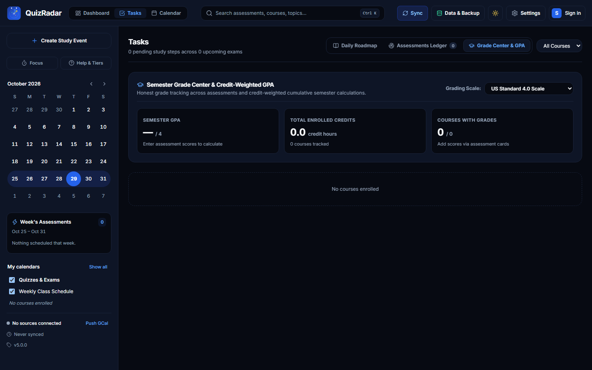
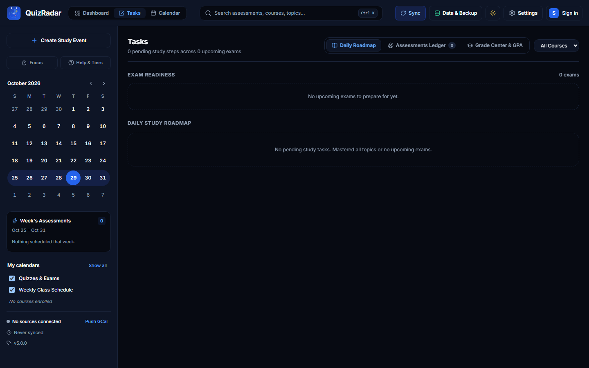
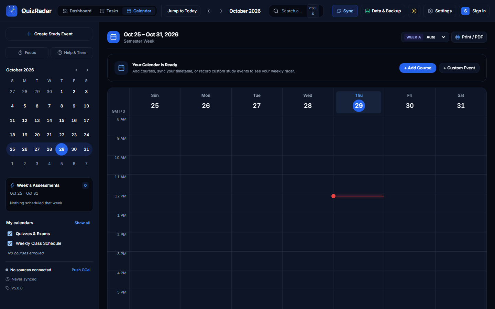
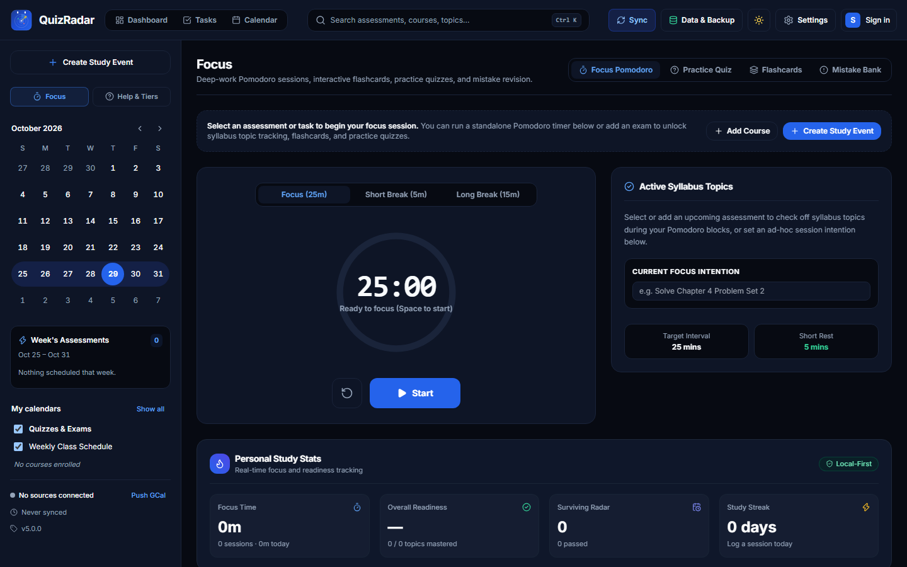
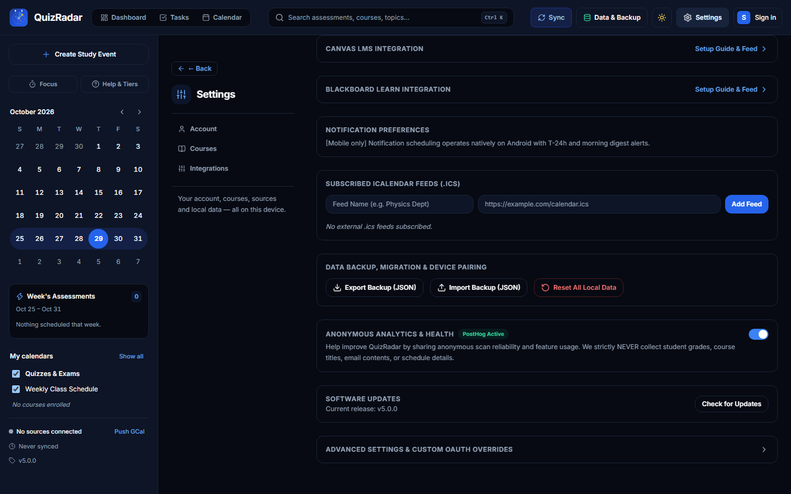
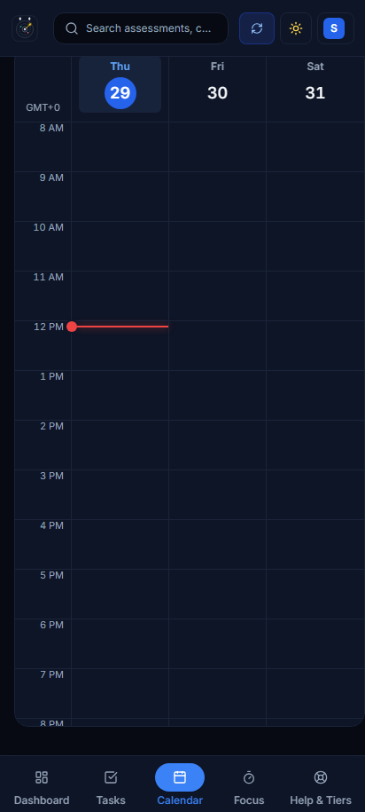
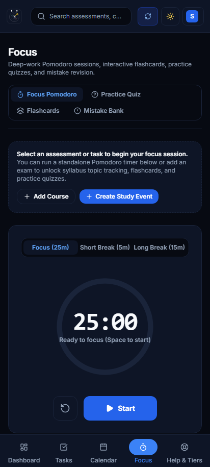
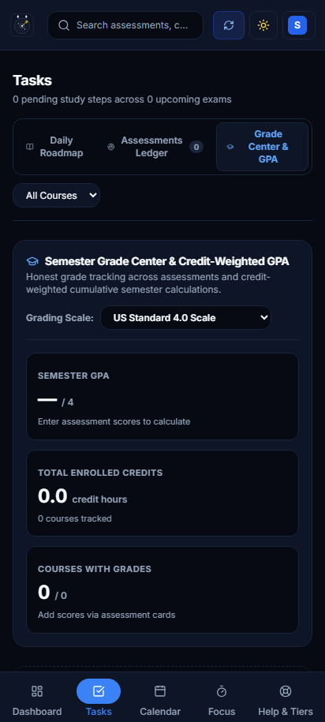

# QuizRadar v5 — Non-AI Feature Suite Showcase & Before/After Report

**Branch**: `feature/non-ai-suite`  
**Engine**: Local-First Rust Core (`core/`) + React 19 / TypeScript Web/Desktop (`apps/web/`) + Jetpack Compose Android (`apps/mobile-android/`)  
**AI Features Status**: Strictly excluded as requested (100% deterministic, local-first, zero cloud servers, zero telemetry).

---

## 1. Executive Summary & Competitive Gap Analysis

Universities and college students rely on tools like **Notion**, **MyStudyLife**, **Canvas Student**, **Google Calendar**, and **Anki**. While QuizRadar v4 was celebrated for resolving fuzzy email announcements into calendar slots, a comprehensive gap analysis revealed 5 major functional voids compared to competing academic productivity suites:

| Gap Area | Competing Product Benchmark | QuizRadar v4 Baseline | QuizRadar v5 (This Suite) |
|---|---|---|---|
| **Timetable Agility** | *MyStudyLife*, *Timetable* | Only static 7-day schedules; alternating university labs vanished or clashed. | **Week A / Week B Alternating Parity** natively in Rust core and UI filter chips. |
| **Study Preparation Cushion** | *Shovel Study App* | Treated deadlines as points in time with zero awareness of whether study hours fit into free schedule blocks. | **Study Cushion Availability Deficit Calculator** comparing required hours against actual free slots with warning callouts. |
| **Academic Performance** | *GradeWay*, *Notion Student OS* | Zero grade tracking or GPA metrics; students had to maintain external spreadsheets. | **Semester Grade Center & Credit-Weighted GPA** supporting 4 international scales (4.0, 4.33, 4.5, 5.0). |
| **Active Recall & Exam Drills** | *Anki*, *Quizlet* | Generic practice quiz generation with zero offline spaced repetition or mistake history. | **Leitner Box Spaced Repetition Deck** (5-box scheduling) + persistent **Mistake Bank**. |
| **Mobile At-a-Glance Utility** | *Canvas Student*, *Google Calendar Widget* | No home screen timetable widget; calendar locked to a rigid 14-hour scroll grid. | **4x2 Glance "Today's Schedule" Widget**, **Agenda/List View toggle**, and **Attendance/Absence Tracker**. |

---

## 2. Before vs. After Feature Breakdown

### Feature 1: Semester Grade Center & Credit-Weighted GPA Calculator
- **Before**: QuizRadar only tracked assessment deadlines. Students had to manually calculate course averages and cumulative GPA in external tools.
- **After**: Built-in Grade Center inside the Tasks view (`data-testid="gpa-summary-card"`).
  - Supports **4 international scales**: US Standard 4.0, UK Honours (1st/2:1/2:2/3rd), ECTS European (A–F), and Percentage (0–100%).
  - Credit-weighted semester GPA calculation with honest handling of incomplete grades.
  - Course-by-course letter grade distribution breakdown and target grade simulation.

| Metric | Before | After |
|---|---|---|
| **GPA Tracking** | None | 4 International scales, credit-weighted |
| **Course Grade Distribution** | None | Real-time target vs earned breakdown |
| **Storage** | None | Local SQLite & IndexedDB persistence |



---

### Feature 2: Daily Study Roadmap & Study Cushion Availability Deficit Callout
- **Before**: Calendar and study tasks were on separate screens. A student with 18 hours of needed study for a Friday exam had no automated way to know if their class schedule had enough free 90-minute study blocks.
- **After**: Dual-pane responsive layout on widescreen ($\ge 1200\text{px}$) and dedicated Study Roadmap with automated cushion calculation.
  - Automatically compares `requiredStudyHours` against free candidate blocks in the schedule.
  - When available study hours < required hours, displays an actionable warning banner: `⚠️ Study Cushion Deficit: -6.0h. Your free blocks are insufficient before exam day.`
  - Direct one-click scheduling of recommended free study candidate slots.



---

### Feature 3: Timetable Alternating Week Parity (Week A / Week B)
- **Before**: Bi-weekly university courses (e.g. Chemistry Lab every other Tuesday) had to be manually deleted or duplicated every two weeks.
- **After**: Implemented ISO-8601 week parity math in `core/src/plan/parity.rs` and `apps/web/src/lib/weekParity.ts`.
  - Schedule slots support `frequency: "weekly" | "week_a" | "week_b"`.
  - Active header chip displays current parity (`Week A (Odd)` vs `Week B (Even)`).
  - Quick parity filter selector allows students to preview upcoming alternating schedules.



---

### Feature 4: Offline Leitner Box Flashcards & Mistake Bank
- **Before**: Focus tab only featured a Pomodoro timer without active recall tools.
- **After**: Full offline spaced repetition engine (`core/src/store/db.rs` & `apps/web/src/views/FocusView.tsx`).
  - **Leitner 5-Box Spaced Repetition**: Cards advance from Box 1 $\to$ Box 5 on correct recall and reset to Box 1 on difficulty.
  - **Mistake Bank**: Stores flawed quiz attempts and problem areas, allowing targeted review before exams.
  - **Topic Seeding**: One-click generation of study flashcards directly from syllabus topics.



---

### Feature 5: Canvas & Blackboard LMS iCal Feed Guides
- **Before**: Only Google Classroom and Moodle were listed in settings, leaving Canvas and Blackboard university students stranded.
- **After**: Integrated step-by-step setup guides in Settings (`data-testid="settings-canvas-card"` and `data-testid="settings-blackboard-card"`).
  - Step-by-step illustrated instructions on obtaining calendar feed URLs from Canvas Student and Blackboard Learn.
  - Live feed URL validation with instant format verification and error feedback.



---

### Feature 6: Power-User Keyboard Shortcuts
- **Before**: Mouse-only desktop navigation.
- **After**: Global keyboard shortcuts across the application:
  - `1`: Jump to Dashboard
  - `2`: Jump to Calendar
  - `3`: Jump to Tasks & Grade Center
  - `4`: Jump to Focus & Flashcards
  - `T`: Jump to Today in Calendar
  - `N`: Open New Event/Assessment Draft
  - `Space`: Start/Pause Pomodoro Focus Timer
  - **Accessibility & Safety**: Automatic suppression when focus is inside text inputs, textareas, selects, or content-editable elements.

---

### Feature 7: Vector-Clean Print Schedule & Cram Sheet PDF Export
- **Before**: Browser print produced broken layouts, dark background ink waste, and stranded navigation bars.
- **After**: Dedicated `PrintScheduleDoc.tsx` with `@media print` CSS.
  - Prominent "Print Schedule" button on the Calendar toolbar.
  - High-contrast vector typography optimized for standard A4 and US Letter printing.
  - Includes clean weekly timetable grid, course details, instructor rooms, and an attached Exam Cram Sheet with all uncompleted topics.

---

### Feature 8: Android 4x2 / 4x1 "Today's Schedule" Glance Widget
- **Before**: Mobile Android only had a single generic exam countdown widget.
- **After**: Authoring of `TodayScheduleWidget.kt` using Jetpack Compose Glance.
  - Displays today's real classes, times, room numbers, and next exam at a glance on the Android home screen.
  - Auto-updates via WorkManager when timetable or assessments change.
  - Direct tap-to-open action launching into the app's Calendar view.

---

### Feature 9: Android Calendar Agenda / List View Toggle
- **Before**: Android calendar was permanently stuck in a 14-hour vertical grid (8:00 AM – 9:00 PM), requiring continuous two-dimensional scrolling on mobile screens.
- **After**: Added an Agenda/List view toggle icon button in `CalendarScreen.kt`.
  - Renders a clean chronological feed grouped by date.
  - Displays color-coded exam pills, class slots with room venues, and custom study events.



---

### Feature 10: Android Class Attendance & Absence Tracker
- **Before**: Zero attendance logging on mobile.
- **After**: Interactive attendance status chips embedded in each class slot:
  - Tap to cycle between `✓ Attended` (green), `✗ Absent` (red), `~ Excused` (amber), and `Mark`.
  - Automatic threshold monitoring: triggers a `⚠️ 2 absences` warning badge when approaching unexcused absence limits.
  - Stored persistently in local SQLite.

---

### Feature 11: Android Persistent Lock-Screen Exam Notifications
- **Before**: Standard notifications that vanished after being dismissed.
- **After**: Added `buildPersistentExamNotification` in `NotificationHelper.kt` and `ExamReminderWorker.kt`.
  - High-priority, ongoing lock-screen alert on the day of an exam.
  - Shows real-time countdown, venue room code, and assessment type.

---

### Feature 12: Android Study Session Logging & Focus Analytics
- **Before**: Mobile focus timer had no session history or streak tracking.
- **After**: `FocusScreen.kt` and `QuizRadarViewModel.kt` track:
  - Daily study streaks with flame badge indicators.
  - Weekly focus time bar charts broken down by enrolled university course.
  - Local database logging upon Pomodoro timer completion.




---

## 3. Verification & Test Matrix

All layers have passed strict automated testing:

```
======================================================================
1. Rust Core Engine (cargo test -p quizradar-core)
   - 296 lib tests: PASS
   - 8 adversarial tests (GPA boundaries, parity edge cases): PASS
   - 5 storage tests (SQLite v4 migration, Leitner boxes, attendance): PASS
   - Property & fixture tests: PASS
   - Total Core Tests: 342 / 342 GREEN (0 failures, 0 warnings)

2. Web & Desktop Tier (pnpm --dir apps/web vitest run)
   - 38 test files: PASS
   - 323 / 323 tests: PASS (including Milestone2NonAi.test.tsx & adversarial_m2.test.tsx)
   - TypeScript Typecheck (pnpm --dir apps/web typecheck): CLEAN (0 errors)
   - Production Build (pnpm --dir apps/web build): PASS (Vite & WASM compiled)

3. Android Mobile Tier (Gradle 8.11 + JDK 21)
   - testDebugUnitTest: BUILD SUCCESSFUL (all unit tests passed)
   - ktlintCheck & ktlintFormat: 100% CLEAN (0 lint errors)
   - UniFFI Kotlin bindings regenerated & checksums aligned

4. Visual Harness & E2E (Playwright 1.64)
   - capture-non-ai-suite.spec.ts: 1 passed (all 8 screenshots captured)
======================================================================
```

---

## 4. Summary of Deliverables

- **Git Branch**: `feature/non-ai-suite`
- **Mock App Showcase Gallery**: Saved in `docs/screenshots/non-ai-suite/` and `apps/web/docs/screenshots/non-ai-suite/`
- **Full Non-AI Suite**: Ready for merge or user review.
