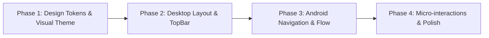

# QuizRadar UI/UX Audit & Comprehensive Redesign Plan
**Target Platforms:** Desktop (Tauri 2 + React 19) & Mobile (Android Jetpack Compose M3)  
**Version Evaluated:** v5.0.0 (Rebuild baseline)  
**Design Theme:** *The Student Observatory* (Academic Radar & Celestial Aesthetics)

---

## Executive Summary & Scorecard

| Surface | Overall Rating | Usability Band | Primary Strengths | Primary UX Bottlenecks |
|---|:---:|:---:|---|---|
| **Desktop App** | **8.1 / 10** | Good (85%) | Keyboard shortcuts (`Cmd+K`, hotkeys), data honesty, Course Color Invariant, responsive modals | TopBar control clutter (10+ items), nested dual-scroll chassis on dashboard, search collision |
| **Android Mobile** | **8.6 / 10** | Very Good (86.3%) | Native M3 fidelity, Glance countdown widget, lifecycle-resilient timers, share-sheet ingest | Navigation drawer + bottom bar redundancy, Dashboard "Study" sub-tab vs Tasks screen overlap |

---

## 0. Spec Conformance Gate (read before Phase 1)

Acceptance for v5 is `docs/rebuild/01-product-spec.md` §8; `docs/rebuild/` and `prompts/` are immutable to agents (`AGENTS.md` rule 9), and work proceeds through the normal one-prompt-per-session phase flow with `docs/STATUS.md` checklist ticks (`AGENTS.md` §6) — not as a standalone redesign branch. Every fix below carries its spec citation; rows marked ⚠ **conflict** with the locked spec and need a maintainer ruling (amend the spec vs. amend this plan) before that item is implemented:

| Plan item | Spec citation | Status |
|---|---|---|
| §4 [P2] Search collision — decouple top search from in-page filtering | `01` §4.8: "typing re-renders dashboard + calendar"; §8 checklist item "search re-render" | ⚠ conflicts |
| §5 [P1] Remove Android Dashboard sub-tab bar | `01` §4.3 mandates the "mobile sub-tab bar (Overview KPI / Assessments / Study)" | ⚠ conflicts |
| §6 Phase 1 tokens `#070A12` / `#F5F7FB` | `01` §6 design language: dark base `#0b0f19`, light `#f8fafc/#ffffff`, accent `#1a73e8` (matches current `apps/web/src/tokens.css`) | ⚠ deviates |
| §5 [P1] Remove `ModalNavigationDrawer` on phones | `01` §4.8 Android back order "… → search palette → sidebar → dashboard → exit" assumes a sidebar | ⚠ conflicts (keep on tablet form factors via `WindowSizeClass`?) |
| §4 [P1] Move view tabs into the Sidebar | `01` §5: "left sidebar on desktop (nav tabs, mini-cal, course filters, layer toggles, sync status footer)" | ✅ aligns |
| §4 [P1] Move Settings out of the TopBar | `01` §5 chrome lists a top-bar "settings gear"; §4.9 settings is a 3-tab modal — the working tree already moves settings to a full-page `SettingsView` | ⚠ in flux |
| §5 [P2] IME padding · [P3] week swipe | additions only; `01` §4.5 mandates the <768px 3-day calendar window, so the swipe must slide that window | ✅ no conflict |

---

## 1. Multi-Dimensional Scorecards (Rated /10 on 7 Foundational Bases)

| Dimension / Basis | Desktop Score (/10) | Android Score (/10) | Desktop Notes | Android Notes |
|---|:---:|:---:|---|---|
| **1. Visual Hierarchy & Spatial Balance** | **7.5** | **7.8** | Cluttered top bar; 2 vertical scroll lists side-by-side compete for attention. | Top hero sky + subtabs + checklist eat 60% of initial viewport height. |
| **2. Navigation & Workflow Ergonomics** | **8.0** | **7.9** | Navigation split between TopBar, Sidebar, and full-screen Settings. | Duplicate navigation menus (BottomBar + Navigation Drawer both show 4 tabs). |
| **3. Usability Heuristics & Status Feedback** | **9.0** | **9.2** | Real sync progress pulses, live Pacific-day AI quota tracker, midnight watchdog. | Glance home-screen widget, live background workers, system notifications. |
| **4. Cognitive Load & Working Memory** | **7.5** | **7.9** | TopBar has 10+ items at once (exceeds Cowan's $\le 4$ limit). Dual search feedback. | Duplicate study management in Dashboard Sub-tab vs Tasks screen. |
| **5. Design System Craft & Theme Consistency** | **8.5** | **9.2** | Solid design tokens, dark/light crossfades, high-contrast action chips. | Tailored M3 tokens, custom elevation, zero default lavender leakage. |
| **6. Error Prevention, Reversibility & Honesty** | **8.8** | **9.0** | Grade editor input bounds, double-confirm modals, zero fake dates or rooms. | Predictive back gesture unwinds sheets; safe SAF file picker error recovery. |
| **7. Accessibility, Contrast & Typography** | **8.5** | **8.8** | Inter Variable typography, tabular numerals (`tnum`), WCAG AA text ratios. | 48dp touch targets, tactile haptics (`LocalHapticFeedback`), screen reader tags. |

---

## 2. Nielsen's 10 Usability Heuristics Deep-Dive

| # | Heuristic | Desktop (/4) | Android (/4) | Core Finding & Evidence |
|---|---|:---:|:---:|---|
| **1** | **Visibility of System Status** | **4.0** | **4.0** | Live sync stage indicators; real last-synced timestamp; reactive Glance widget on Android. |
| **2** | **Match Between System & Real World** | **3.5** | **3.8** | Domain-accurate student concepts (classes, lecture slots, quizzes, GPA weightage). Native Android share intents. |
| **3** | **User Control & Freedom** | **3.5** | **3.8** | LIFO `Escape` stack dismissal on all modals; predictive back gesture dispatches in strict reverse order. |
| **4** | **Consistency & Standards** | **3.0** | **3.2** | Both platforms suffer from navigational split (Desktop: TopBar vs Sidebar; Android: Drawer vs BottomBar). |
| **5** | **Error Prevention** | **3.5** | **3.5** | Grade editor validates negative numbers and `score > max`; backup imports guarded by integrity schemas. |
| **6** | **Recognition Rather Than Recall** | **3.0** | **3.2** | Course colors preserved everywhere. Minor gap: jumping multiple weeks in calendar requires repeated clicking. |
| **7** | **Flexibility & Efficiency of Use** | **4.0** | **3.5** | Desktop: Single-key accelerators (`D`/`T`/`C`/`F`/`S`/`?`) & `Cmd+K`. Android: Quick share-sheet ingest. |
| **8** | **Aesthetic & Minimalist Design** | **2.5** | **3.0** | Heavy "box-inside-a-box" border nesting; visual noise on main screens due to stacked bordered cards. |
| **9** | **Error Recovery** | **3.5** | **3.5** | Plain-language error messages (e.g. "Google token expired — re-authenticate" instead of generic error codes). |
| **10** | **Help & Documentation** | **3.5** | **3.0** | Desktop has a dedicated `/help` view with shortcut cheatsheets; Android lacks an in-app help/FAQ sheet. |
| **Total** | | **34.0 / 40 (85.0%)** | **34.8 / 40 (87.0%)** | **Good / Very Good Rating Band** |

> **Note on row 7 (Flexibility & Efficiency):** the `Cmd+K` / single-key accelerator credit assumes the `01` §4.8 keyboard handlers (`/` or Ctrl/⌘K focuses search, ordered `Escape`) are actually wired. A case-insensitive recursive grep of `apps/web/src` finds no `keydown` / `onKeyDown` / `KeyK` handling yet — verify the hotkeys exist in code before claiming them in the scorecard.

---

## 3. Visual Redesign: *The Student Observatory*

### The Aesthetic Concept
QuizRadar resolves fuzzy university announcements through weekly timetable cross-referencing. The visual metaphor is an **astronomical observatory**: scanning the sky, detecting radar signals, and charting clear constellations.

```
┌────────────────────────────────────────────────────────┐
│  DEEP MIDNIGHT SKY (Obsidian #070A12 + Faint Nebula)   │
│  ┌──────────────────────────────────────────────────┐  │
│  │ FROSTED GLASS PANELS (rgba(15,21,36,0.75) + 16px)│  │
│  │  ┌────────────────────────────────────────────┐  │  │
│  │  │ COURSE CONSTELLATIONS (Luminous Accents)   │  │  │
│  │  │ • Sapphire (#1A73E8) • Emerald (#0F9D58)   │  │  │
│  │  │ • Amethyst (#8E24AA) • Amber (#EA8600)     │  │  │
│  │  └────────────────────────────────────────────┘  │  │
│  └──────────────────────────────────────────────────┘  │
└────────────────────────────────────────────────────────┘
```

> **Invariant — course colors:** the constellation accents (Sapphire / Emerald / Amethyst / Amber) are decorative UI accents only. Course colors stay the user-chosen 8-preset derivation in `core/` (`core/src/types.rs`: "chosen from the 8-preset palette"; "no default demo palettes"). The theme palette must never assign or override a course color (`AGENTS.md` golden rule 4).

### Key Visual Upgrades

1. **Expanding the Starry Sky Motif**:
   - The twinkling stars and breathing sun in `HeroSky.kt` and `NextUpHero` are currently isolated to one card.
   - Weave subtle micro-stars and stardust gradients into the Desktop sidebar header, the Android Pomodoro focus dial, and the Calendar header.
2. **Atmospheric Tonal Palettes (Goodbye Bland Slate)**:
   - **Dark Mode**: Shift from generic `#111827` (slate-900) to **Obsidian Midnight** (`#070A12`), with cards styled as frosted translucent glass (`rgba(15, 21, 36, 0.75)` with `backdrop-filter: blur(16px)`).
   - **Light Mode**: Warm academic sky (`#F5F7FB`) with soft periwinkle ambient glows and gentle shadows rather than harsh borders.
3. **Curing "Box-Inside-a-Box" (Unboxing Cards)**:
   - Eliminate 1px inner borders on facts grids, topic rows, and metadata chips.
   - Use soft background contrast (`var(--surface-hover)` or `color-mix(in srgb, var(--accent) 5%, transparent)`) and generous **16px–20px corner radii**.
4. **Constellation Micro-Delights**:
   - **Orbital Pomodoro Dial**: The focus timer progress ring features an orbiting star indicator that gently breathes during study sprints.
   - **Constellation Sparkle**: Toggling a study topic done emits a subtle golden particle shimmer before settling into a clean strike-through.
   - **Nebula Exam Glow**: Active deadlines within 48 hours pulse with a breathing ruby-to-amber radial aura.

---

## 4. Desktop UI/UX Issues & Proposed Fixes

### [P1] TopBar Control Overcrowding
- **Location:** [`apps/web/src/components/TopBar.tsx`](file:///d:/Projects/QuizRadar/apps/web/src/components/TopBar.tsx#L195-L490)
- **Problem:** Holds 10+ controls simultaneously (Brand, Update Pill, 3-tab View Switcher, Calendar Nav, Search Bar, Scan CTA, Data & Backup, Theme, Settings, Account). On 13"/14" laptops, search shrinks to an unusable sliver.
- **Fix:**
  1. Move the 3 view tabs (Dashboard, Tasks, Calendar) into the **Sidebar**, creating a unified navigation rail above Focus and Help.
  2. Move Data & Backup and Settings into the **Account Profile dropdown**.
  3. Keep the TopBar minimal: `[Sidebar Toggle + Brand]` | `[Global Search (Cmd+K)]` | `[Sync Pill]` | `[Theme Toggle]` | `[Account Profile]`.
- **Spec:** moving the view tabs into the Sidebar aligns with `01` §5 (the sidebar owns the nav tabs). Moving Settings out of the top bar touches the `01` §5 chrome spec (top-bar "settings gear") and §4.9 (settings modal) — follow the in-progress settings-page redo (`apps/web/src/views/SettingsView.tsx`) and confirm with the maintainer.

### [P1] Dual-Scrolling Container Trap on Dashboard
- **Location:** [`apps/web/src/views/DashboardView.tsx`](file:///d:/Projects/QuizRadar/apps/web/src/views/DashboardView.tsx#L573-L630)
- **Problem:** Left panel ("What Should I Study?") and right panel ("Assessments Radar") have rigid `lg:h-[720px]` caps with internal scrollbars inside an already scrollable main window, creating mouse wheel traps on laptops.
- **Fix:** Remove fixed `h-[720px]` caps. Allow the page to scroll smoothly as a single continuous surface, or adopt a viewport-locked grid (`calc(100vh - 64px)`) where columns stretch responsively without inner scroll hijacking.

### [P2] Search Interaction Collision
- **Location:** [`apps/web/src/components/SearchDropdown.tsx`](file:///d:/Projects/QuizRadar/apps/web/src/components/SearchDropdown.tsx)
- **Problem:** Typing into the top search bar simultaneously opens a floating results dropdown **and** re-filters the Dashboard and Calendar views underneath.
- **Fix:** Decouple global search from in-page filtering:
  - TopBar search acts as a command palette (`SearchPaletteModal`) for jumping to items.
  - In-page filtering is handled by dedicated filter controls inside the respective view headers.
- **⚠ Spec conflict:** `01` §4.8 mandates "typing re-renders dashboard + calendar" and the §8 checklist includes "search re-render" — decoupling requires a maintainer ruling; do not implement as-is. Also note `SearchPaletteModal` does not exist in the codebase yet: the spec'd palette (`/` or Ctrl/⌘K, recents, suggestions, top-4 matches) is new build work, not a rewire.

### [P2] Settings View Context Detachment
- **Location:** [`apps/web/src/views/SettingsView.tsx`](file:///d:/Projects/QuizRadar/apps/web/src/views/SettingsView.tsx)
- **Problem:** Navigating to Settings replaces the main view area without a breadcrumb or clear back button, making the user feel stranded outside the app.
- **Fix:** Add a sticky header with a prominent `← Back to Dashboard` button and clear breadcrumb (`Settings / Integrations`).
- **Spec:** consistent with the in-progress settings-page redo (`apps/web/src/views/SettingsView.tsx`); `01` §4.9 / §5 still describe a settings *modal*, so the modal→view change should be recorded with the maintainer.

---

## 5. Android UI/UX Issues & Proposed Fixes

### [P1] Duplicate Navigation: Drawer vs. BottomBar
- **Location:** [`AppScaffold.kt`](file:///d:/Projects/QuizRadar/apps/mobile-android/app/src/main/java/com/quizradar/app/ui/AppScaffold.kt#L246-L320)
- **Problem:** The app has a bottom `NavigationBar` with 4 destinations (*Dashboard, Tasks, Calendar, Focus*) and a `ModalNavigationDrawer` that opens from the brand logo with the *exact same 4 destinations*.
- **Fix:** Remove `ModalNavigationDrawer` on mobile phone form factors. Use the `NavigationBar` exclusively. Secondary links (*Settings*, *Accounts & Sources*) are accessed via the TopAppBar user avatar sheet.
- **⚠ Spec conflict:** the `01` §4.8 Android back-button order ("… → search palette → sidebar → dashboard → exit") assumes a sidebar exists; if the drawer is removed on phones, keep it on tablet form factors (`WindowSizeClass`) and get a maintainer ruling on the back-order step.

### [P1] Architecture Collision: Dashboard "Study" Sub-Tab vs. "Tasks" Screen
- **Location:** [`DashboardScreen.kt`](file:///d:/Projects/QuizRadar/apps/mobile-android/app/src/main/java/com/quizradar/app/ui/screens/DashboardScreen.kt#L260-L327)
- **Problem:** The Dashboard features an internal sub-tab (`Overview`, `Assessments`, `Study`). The `Study` sub-tab duplicates the dedicated `Tasks` bottom navigation screen.
- **Fix:**
  - Simplify the Dashboard into a unified overview (Next-Up Hero + Conflict Alerts + Upcoming Radar Timeline + Readiness summary).
  - Remove the 3-way sub-tab segmented control.
  - Tapping the Readiness card deep-links the user directly to the **Tasks** screen for full topic tracking.
- **⚠ Spec conflict:** `01` §4.3 mandates the mobile sub-tab bar (Overview / Assessments / Study) — do not remove it without a spec amendment.

### [P2] Viewport Overcrowding on First Launch
- **Location:** [`DashboardScreen.kt`](file:///d:/Projects/QuizRadar/apps/mobile-android/app/src/main/java/com/quizradar/app/ui/screens/DashboardScreen.kt#L250-L360)
- **Problem:** TopAppBar + NextUpHeroCard + SubTabs + ConflictBanner + SetupChecklistCard pushes all actual exam content off the screen.
- **Fix:**
  - Collapse `NextUpHeroCard` to a compact banner ($\le 90$dp) when no exam is due within 48 hours.
  - Make `SetupChecklistCard` a dismissible compact pill banner rather than a full vertical block.

### [P2] Virtual Keyboard (IME) Overlap in Grade Editor
- **Location:** [`AssessmentDetailSheet.kt`](file:///d:/Projects/QuizRadar/apps/mobile-android/app/src/main/java/com/quizradar/app/ui/detail/AssessmentDetailSheet.kt#L101-L140)
- **Problem:** Typing grades in the bottom sheet causes the software keyboard to cover the input fields and "Save Grade" CTA.
- **Fix:** Add `.imePadding()` to the sheet's scrolling column and bind `BringIntoViewRequester` to the focused grade inputs.

### [P3] Calendar 3-Day Sliding Window Navigation
- **Location:** [`CalendarScreen.kt`](file:///d:/Projects/QuizRadar/apps/mobile-android/app/src/main/java/com/quizradar/app/ui/screens/CalendarScreen.kt)
- **Problem:** Navigating forward requires tapping `<` and `>` repeatedly.
- **Fix:** Implement a horizontal swipe gesture (`HorizontalPager` or drag gesture) to flip between weeks naturally.
- **Spec:** addition only — `01` §4.5 mandates the <768px 3-day calendar window on phones; the swipe must slide that 3-day window, never widen it to 7 days.

---

## 6. Phased Implementation Roadmap



### Phase 1: Tokens & "Observatory" Visual Foundation
- Update `apps/web/src/tokens.css` with Obsidian dark variables, frosted glass tokens, and soft ambient shadows.
- Update `QuizRadarTheme.kt` with matching dark elevation colors and gradient border definitions.
- Refine `.has-exam-glow` and Android exam badges to use the breathing crimson nebula glow.
- Keep the `01` §6 design-language tokens (`#0b0f19` dark base, `#f8fafc/#ffffff` light, accent `#1a73e8`) unless the maintainer rules otherwise — the `#070A12` / `#F5F7FB` proposal in §3 deviates (see §0 gate).
- Any phase that changes rendered UI must regenerate the Playwright `e2e-baselines` (`apps/web/e2e-baselines/`) and re-run the visual acceptance pass in that same phase — not only in Phase 4.

### Phase 2: Desktop Navigation & Scroll Modernization
- Refactor `TopBar.tsx` to streamline controls down to 5 essential items.
- Move primary view switches (`Dashboard`, `Tasks`, `Calendar`) into `Sidebar.tsx`.
- Remove fixed `h-[720px]` caps in `DashboardView.tsx` to restore natural scrolling.
- Add back button and breadcrumb header to `SettingsView.tsx`.

### Phase 3: Android Architecture & Ergonomic Cleanup
- Remove the redundant `ModalNavigationDrawer` on compact screens in `AppScaffold.kt`.
- Remove the Dashboard sub-tab bar in `DashboardScreen.kt`; route "Study" clicks to `TasksScreen.kt`.
- Apply `.imePadding()` to `AssessmentDetailSheet.kt`.
- Add week-swipe gestures to `CalendarScreen.kt`.

### Phase 4: Micro-Interactions & Delights
- Implement the orbital star indicator on the Focus / Pomodoro timer ring.
- Add subtle constellation checkmark sparkles on topic completion.
- Honor `prefers-reduced-motion`: disable (or replace with static states) the breathing nebula exam glow, topic-completion sparkles, and the orbital Pomodoro indicator; never encode meaning in motion alone.
- Verify contrast ratios (WCAG AA), Playwright baselines, and Robolectric test suites.
