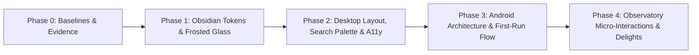

> **ARCHIVED 2026-11-10** — executed: the v3 ratified roadmap landed across the Student-Observatory
> redesign rounds (see `docs/worklog/2026-11.md` / merged `design/landing-student-clarity`). Kept as
> a historical record; must not be treated as open work.

# QuizRadar UI/UX Audit & Redesign Plan
**Target Platforms:** Desktop (Tauri 2 + React 19) & Mobile (Android Jetpack Compose M3)
**Version Evaluated:** v5.0.0 (Rebuild baseline)
**Design Theme:** *The Student Observatory* (Academic Radar & Celestial Aesthetics — Obsidian Rebase)
**Plan revision:** v3 (2026-11-05) — **RATIFIED BY MAINTAINER**. All 5 spec-conflict items resolved via `/grill-me` rulings; Obsidian rebase approved; roadmap unified for execution across Desktop and Android.

> **Why v3 exists.** v2 captured the runtime-verified critique and isolated 5 ⚠ spec conflicts. During the 2026-11-05 maintainer grill session, all 5 decisions were resolved and ratified: (1) Floating `SearchPaletteModal` with compact TopBar trigger; (2) Dashboard sub-tab bar removed in favor of single feed + Tasks tab; (3) Android drawer removed on compact phones; (4) Obsidian dark base `#070A12` / `#F5F7FB` + frosted glass approved; (5) Full-page `SettingsView` formally ratified. v3 unblocks end-to-end execution across Phases 0–4.

---

## 0. Spec Conformance Gate (Ratified Status)

Acceptance for v5 is `docs/rebuild/01-product-spec.md` §8. All maintainer rulings below amend or clarify the spec citations accordingly.

| Plan item | Spec citation | Status | Maintainer Ruling |
|---|---|:---:|---|
| §4 [P2] Search Architecture | `01` §4.8: "typing re-renders dashboard + calendar"; §8 checklist item "search palette" | ✅ **Ratified** | Build floating `SearchPaletteModal` (`⌘K` / `/`), compact TopBar search trigger, keep live in-view filtering active. |
| §5 [P1] Android Dashboard sub-tab bar | `01` §4.3 mandates "mobile sub-tab bar (Overview KPI / Assessments / Study)" | ✅ **Ratified** | **Spec §4.3 Amended**: Remove sub-tabs; make Dashboard a single continuous feed; bottom nav "Tasks" owns all Study items. |
| §7 Phase 1 Obsidian Rebase (`#070A12` / `#F5F7FB`) | `01` §6 design language: dark base `#0b0f19`, light `#f8fafc/#ffffff` | ✅ **Ratified** | **Spec §6 Amended**: Adopt Obsidian dark base `#070A12`, light `#F5F7FB`, and frosted glass (`backdrop-blur-md` on desktop). |
| §5 [P1] Android `ModalNavigationDrawer` on phones | `01` §4.8 back order "… → search palette → sidebar → dashboard → exit" | ✅ **Ratified** | Remove drawer on compact phones (<600dp); bottom bar owns tabs; retain drawer/rail on tablets (≥600dp). |
| §4 [P1] Move view tabs into Desktop Sidebar | `01` §5: "left sidebar on desktop (nav tabs, mini-cal, course filters, layer toggles, sync status footer)" | ✅ **Ratified** | Tabs move into Sidebar; collapsed Sidebar animates to an icon-only quick rail (D/T/C/F always 1-click reachable). |
| §4 [P1] Settings view vs modal | `01` §4.9 settings is a 3-tab modal; §5 chrome lists top-bar "settings gear" | ✅ **Ratified** | **Spec §4.9 Amended**: Formally adopt full-page `SettingsView` with sticky header, back button (`← Back`), and breadcrumbs. |
| §4 [P2] Token-purity color pass | `01` §6 locked tokens; removes off-token drift | ✅ **Ratified** | Purge hardcoded gradients & Gemini purple; route all accents through tokens; keep 8 course presets strictly invariant. |
| §4/§5 [P1/P2] Empty-state CTAs + corrected copy | §8 "honest sync messaging everywhere"; honesty doctrine | ✅ **Ratified** | Four-state empty pattern with actionable CTAs on Desktop and Android; fix attribution text. |
| §5 [P2] IME padding · [P3] week swipe | `01` §4.5 3-day calendar window on phones | ✅ **Ratified** | Apply `.imePadding()` to grade editor sheet; add horizontal swipe to slide the 3-day window. |
| §5 [P2] Android in-app help sheet | Parity with desktop Help & Tiers | ✅ **Ratified** | Compact Help/FAQ sheet accessible from Settings and Account. |
| §7 Micro-delights (Observatory aesthetic) | Celestial visual cues, `prefers-reduced-motion` honored | ✅ **Ratified** | Quiet & elegant: ultra-subtle stardust, gentle 4s breathing aura on 48h deadlines, shimmer checkmark, orbital Pomodoro star. |

---

## 1. Executive Summary & Scorecard (Runtime-Verified)

| Surface | Overall Rating | Nielsen Total | Primary Strengths (verified) | Primary UX Bottlenecks (verified) |
|---|:---:|:---:|---|---|
| **Desktop App** | **7.3 / 10** | **31 / 40 (Good)** | Honesty as a designed system (4 differentiated empty states, filter banners with Clear, named failure causes); keyboard model (D/T/C/F/?/S + `/`, verified `App.tsx:113-157`); exemplary modal focus trap (`ModalStack.tsx:45-92`); token + motion foundation | First-run Calendar/Tasks dead-end shells (`views.tsx:52-83`); TopBar overflows at the app's own 1420×880 default (search truncates, Sync vanishes in Calendar mode); accessibility debt (179× `text-[11px]`, five 2.5:1 placeholders, skipped `h2→h4`); off-token indigo/purple drift; "Synced" label converts the primary CTA into a receipt |
| **Android App** | **6.9 / 10** | **27 / 40 (Acceptable, borderline Good)** | A11y discipline in code (labeled icon buttons, `stateDescription` connected-dot, closed drawer `invisibleToUser`, contrast-documented `StatusColors`); adaptive nav (rail ≥600dp, centered 840dp cap); predictive back unwinds in strict reverse order; drafts preserved on failed saves | Onboarding step-3 Connect action is an invisible ~126px unlabeled hit strip (primary first-run action); recurring text-clipping under trailing controls (Setup Checklist, Settings); step 2 routes the core import out of the wizard; spurious "Gemini key removed" toast; empty states honest but passive (no CTAs); no in-app help |

---

## 2. Multi-Dimensional Scorecards (Rated /10 on 8 Foundational Bases)

| Dimension / Basis | Desktop | Android | Evidence notes (v2) |
|---|:---:|:---:|---|
| **1. Visual Hierarchy & Spatial Balance** | **7.5** | **7.0** | Signature radar-sky hero works on both platforms. Desktop: fixed `lg:h-[720px]` panels (`DashboardView.tsx:573,629`) float empty states atop ~400px voids; "Daily Study Roadmap" title duplicated by its own section header. Android: onboarding step 3 is two-thirds dead space; setup rows visually collide with their buttons. |
| **2. Navigation & Workflow Ergonomics** | **7.0** | **7.0** | Desktop: keyboard model excellent, but first-run Calendar/Tasks are dashed-box dead ends while top-bar week arrows control a grid that isn't rendered; Calendar-mode top bar overflows at 1420×880. Android: bottom bar + drawer redundancy is real; "Import Backup File" lives under the Add (+) menu. |
| **3. Status Feedback & Empty States** | **7.5** | **6.5** | Desktop best-in-class: four semantically distinct empty states (`DashboardView.tsx:589-784`), "Showing matches for 'quiz'" banner with Clear. BUT the Sync button relabels to "Synced" and Sync disappears in Calendar mode. Android: honest counts everywhere ("0 pending study steps across 0 upcoming exams") but empty states have no CTAs, "No exams matching this course filter." is misattributed when zero courses exist, and spurious toast fires. |
| **4. Cognitive Load & Working Memory** | **7.0** | **6.5** | Desktop: top-bar action cluster holds 5 controls + search; onboarding step 2 stacks 6 connection cards. Android: step 2's tip sends the user to Settings → Courses & Timetable → AI Course Import mid-wizard; "OAuth client ID (Settings -> Sources)" is developer prose in a first-run flow. |
| **5. Design System Craft & Theme Consistency** | **7.0** | **7.5** | Token layer matches locked brief. Desktop drift: hard-coded `from-blue-700 to-indigo-800` gradients, purple Gemini accents, KPI unit labels in emerald/purple that read as semantics; palette shows 6 colors in onboarding (`.slice(0, 6)`) vs 8 in Add Course. Android: checklist rows render with inconsistent layouts between items. |
| **6. Error Prevention, Reversibility & Honesty** | **9.0** | **8.0** | Non-dismissable scan overlay, "0 (browser tier counts in memory — it resets on reload)", "We never claim fake authentication", loud named sign-in failures, draft-preserving event sheet on Android, Retry on load error. Desktop date trap: "DATE (YYYY-MM-DD)" label over a locale MM/DD/YYYY input. Android: spurious key-removal toast. |
| **7. Accessibility, Contrast & Typography** | **6.0** | **8.0** | Desktop measured debt: 179× `text-[11px]` across `apps/web/src`, 5 input placeholders at **2.5:1** (#9ca3af on #ffffff), skipped heading `h2→h4` (`SettingsView.tsx:657/674`), ~28px mini-calendar targets. Android benchmark: labeled icon buttons, `stateDescription`, theme-aware `StatusColors`; remaining: clipped text rows, wizard CTA below the fold on step 3. |
| **8. First-Run, Onboarding & Help** | **7.0** | **5.5** | Desktop: 3-step wizard completes honestly; Help & Tiers is strong; first-run Calendar/Tasks dead ends land right at finish line. Android: step 3's Connect action is invisible, step 2 routes import out of wizard, primary CTA is negative path ("Continue Without Courses"), no in-app help in drawer. |

---

## 3. Nielsen's 10 Usability Heuristics Deep-Dive

| # | Heuristic | Desktop (/4) | Android (/4) | Core Finding & Evidence |
|---|---|:---:|:---:|---|
| **1** | **Visibility of System Status** | **3** | **3** | Real sync pulses, toasts, honest timestamps. Desktop: "Synced" relabels the primary CTA; Sync vanishes in Calendar mode. Android: spinner only — no per-source scan progress during a scan. |
| **2** | **Match Between System & Real World** | **3** | **3** | Student vocabulary good (Class Quiz, Midterm, Moodle). Leaks: "Push GCal", "API Key (BYOK)", "OAuth client ID", Help's "Per-Tier Capability Matrix", ASCII `->` arrows in Android copy. |
| **3** | **User Control & Freedom** | **3** | **3** | Esc/backdrop/Cancel everywhere; LIFO focus-trapped dismissal (`ModalStack.tsx:45-92`); predictive back unwinds sheets in strict reverse order (`AppScaffold.kt:178-201`); "Re-open Onboarding Wizard" escape hatch. No undo for course delete in onboarding step 3. |
| **4** | **Consistency & Standards** | **2** | **3** | Desktop: off-token gradients/hues, two empty-state strategies, palette 6 vs 8, date-label mismatch. Android: checklist row layouts differ between items; settings rows collide with controls. |
| **5** | **Error Prevention** | **3** | **3** | Grade editor bounds, guarded OAuth copy, non-dismissable scan overlay; debounced autosave with draft preservation. Date-format trap invites silent wrong-date entry. |
| **6** | **Recognition Rather Than Recall** | **3** | **2** | Desktop: adaptive source pills, search scopes. Android: step-3 Connect affordance is invisible and AI Course Import is hidden in Settings. |
| **7** | **Flexibility & Efficiency of Use** | **4** | **2** | Desktop: single-key accelerators D/T/C/F/?/S + `/` verified live (`App.tsx:113-157`). Android: search sheet + widget pin; no recents/quick actions. |
| **8** | **Aesthetic & Minimalist Design** | **2** | **3** | Desktop: 720px panel voids, duplicated section title, "Search assessmer" truncation. Android: clean and on-token; step-3 dead space and clipped rows cost it. |
| **9** | **Error Recovery** | **4** | **3** | Desktop: four differentiated empty states, honest zero-results, named failure causes. Android: Retry on load error, causes named in toasts; some dead ends (Practice Quiz empty state has no action). |
| **10** | **Help & Documentation** | **4** | **2** | Desktop Help & Tiers is strong. Android has no help entry anywhere in the drawer or settings. |
| **Total** | | **31 / 40 (77.5%)** | **27 / 40 (67.5%)** | **Desktop: Good. Android: Acceptable (borderline Good).** |

---

## 4. Desktop Findings & Fixes (apps/web — Tauri desktop shell + PWA)

### [P1] First-run Calendar and Tasks are dead-end shells
- **Location:** [`apps/web/src/views/views.tsx`](file:///d:/Projects/QuizRadar/apps/web/src/views/views.tsx#L52-L83)
- **Problem:** Short-circuits into a bare dashed box ("No classes or exams scheduled for this week.") with zero actions, hiding the real `CalendarView` which has an empty guide with CTAs.
- **Fix:** Delete the short-circuits; let the in-view empty guides render; add mobile week navigation.

### [P1] TopBar: Overcrowded & overflowing at default 1420×880
- **Location:** [`apps/web/src/components/TopBar.tsx`](file:///d:/Projects/QuizRadar/apps/web/src/components/TopBar.tsx#L195-L490)
- **Fix (Ratified):**
  1. Move the 4 primary view tabs (Dashboard, Tasks, Calendar, Focus) into the **Sidebar**.
  2. Collapsed Sidebar animates into a sleek icon-only rail (D/T/C/F always 1-click reachable) + keyboard hotkeys.
  3. Move Data & Backup and Settings into the **Account Profile dropdown**.
  4. Build the floating **`SearchPaletteModal`** (`⌘K` / `/` trigger, recent searches, top-4 matches, direct navigation). TopBar search becomes a compact trigger input that expands or opens the palette, keeping live in-view filtering synced.
  5. Minimal TopBar: `[Sidebar Toggle + Brand] | [Search Palette Trigger] | [Permanent Sync CTA + Status line] | [Theme] | [Account]`.

### [P2] Accessibility debt sweep
- **Evidence:** 179× `text-[11px]` across `apps/web/src`; 5 input placeholders at 2.5:1 contrast (#9ca3af on #ffffff); skipped heading `h2→h4` in Settings; ~28px mini-calendar targets.
- **Fix:** Tokenize body text at ≥12-13px; update placeholder/label colors to AA `--text-muted`; insert missing `h3`; mini-calendar day targets ≥40px.

### [P2] Token-purity color pass
- **Evidence:** Hardcoded indigo/violet gradients, purple Gemini accents, KPI unit labels in semantic colors ("0 exams" in celebration purple).
- **Fix:** Route all gradients and accents through `tokens.css`; KPI unit labels neutral; reserve emerald strictly for positive state; unify onboarding palette to all 8 presets (`.slice(0, 8)`).

### [P2] Density surfaces & natural scrolling
- **Evidence:** Fixed `lg:h-[720px]` caps on both dashboard panels create inner-scroll wheel traps and ~400px voids; duplicate "Daily Study Roadmap" headers.
- **Fix:** Content-sized panels with a sensible `min-height`; drop duplicate header; add reassurance copy to Cloud Backup modal.

### [P2] "Synced" — status wearing an action's clothes
- **Fix:** Permanent Scan/Sync button with separate honest status line ("Synced · 0 new, 0 updated").

### [P2] Settings view context detachment
- **Fix:** Sticky header with prominent `← Back` button and breadcrumb (`Settings / Integrations`). Catch `vt.ready` in `store.ts:134-147`.

### [P3] Date entry format mismatch
- **Fix:** Replace "DATE (YYYY-MM-DD)" with locale-neutral label and format helper.

---

## 5. Android Findings & Fixes (apps/mobile-android)

### [P1] Onboarding step 3: Connect action hit target
- **Location:** [`OnboardingWizardScreen.kt`](file:///d:/Projects/QuizRadar/apps/mobile-android/app/src/main/java/com/quizradar/app/ui/screens/OnboardingWizardScreen.kt)
- **Fix:** Make entire card a single clickable surface with visible trailing "Connect →"; halve dead space.

### [P1] Step 2: Inline Timetable Import & Course Entry
- **Fix (Ratified):** Provide dual equal actions inside the courses card: "Import Timetable Photo" (opens camera/gallery picker with vision timetable extraction) alongside "+ Add Course Manually". Retitle primary bottom button to "Continue →". Replace ASCII `->` with `→`.

### [P1] Remove Dashboard Sub-Tab Bar & Simplify Information Architecture
- **Location:** [`DashboardScreen.kt`](file:///d:/Projects/QuizRadar/apps/mobile-android/app/src/main/java/com/quizradar/app/ui/screens/DashboardScreen.kt)
- **Fix (Ratified):** Remove the sub-tab bar (Overview / Assessments / Study). Make Dashboard a single continuous feed (Hero + Conflict Banner + Next 7 Days Timeline). Let the bottom navigation "Tasks" tab exclusively own all study topics and recommendations.

### [P1] Remove `ModalNavigationDrawer` on Compact Phones (<600dp)
- **Location:** [`AppScaffold.kt`](file:///d:/Projects/QuizRadar/apps/mobile-android/app/src/main/java/com/quizradar/app/ui/AppScaffold.kt)
- **Fix (Ratified):** Remove the drawer on phones (<600dp) to eliminate double-tab redundancy and edge-swipe collisions. Rely on the M3 bottom bar for the 4 primary tabs, and TopAppBar for Search, Add (+), and Account/Settings. Retain drawer/navigation rail on tablets (≥600dp).

### [P1] Text-clipping under trailing controls
- **Locations:** [`SetupChecklistCard.kt`](file:///d:/Projects/QuizRadar/apps/mobile-android/app/src/main/java/com/quizradar/app/ui/components/SetupChecklistCard.kt) and `SettingsScreen.kt`.
- **Fix:** Give trailing controls a fixed lane and the text `weight(1f)` with end padding; shorten OAuth checklist copy.

### [P2] Spurious "Gemini key removed" toast
- **Fix:** `announce = false` when saving an unchanged or empty key in `OnboardingWizardScreen.kt:836`.

### [P2] Empty states: Four-state pattern with actionable CTAs
- **Fix:** Port the web app's four-state pattern (first-run, all-clear, search-miss, filter-excluded) with CTAs (Add Course, Import, Create Event). Correct the misattributed "No exams matching this course filter" when 0 courses exist.

### [P2] Viewport overcrowding on first launch
- **Fix:** Collapse `NextUpHeroCard` to a compact banner (≤90dp) when no exam is due within 48h; make `SetupChecklistCard` a compact dismissible pill.

### [P2] Virtual keyboard (IME) overlap & Help Sheet
- **Fix:** `.imePadding()` on `AssessmentDetailSheet.kt`; add compact in-app Help/FAQ sheet accessible from Settings and Account.

### [P3] Calendar 3-day sliding window navigation
- **Fix:** Horizontal swipe gesture to slide the 3-day window.

---

## 6. Ratified Maintainer Rulings Summary

1. **Search Architecture (`01` §4.8):** Build floating `SearchPaletteModal` (`⌘K` / `/`), reduce TopBar search to a compact trigger, preserving live in-view filtering via active query.
2. **Android Dashboard Sub-Tabs (`01` §4.3):** Spec amended — sub-tab bar removed; Dashboard is a clean continuous feed; bottom nav "Tasks" owns all Study items.
3. **Android Navigation Drawer (`01` §4.8):** Drawer removed on compact phones (<600dp); bottom bar owns tabs; retain drawer/rail on tablets (≥600dp).
4. **Obsidian Rebase Tokens (`01` §6):** Spec amended — dark base `#070A12`, light base `#F5F7FB`, frosted glass panels (`backdrop-blur-md` on desktop, deep elevation on Android).
5. **Settings Architecture (`01` §4.9):** Spec amended — Settings is a full-page view with sticky header, back button (`← Back`), and breadcrumbs.

---

## 7. Visual Redesign: *The Student Observatory* (Obsidian Rebase)

### Aesthetic Concept
The visual metaphor is an **astronomical observatory**: scanning academic signals, charting constellations of courses and deadlines against an obsidian cosmic backdrop.

```
┌────────────────────────────────────────────────────────┐
│  OBSIDIAN TOKENS (dark #070A12 · light #F5F7FB)        │
│  ┌──────────────────────────────────────────────────┐  │
│  │  FROSTED GLASS SURFACES (backdrop-blur-md 16px)  │  │
│  │  ┌────────────────────────────────────────────┐  │  │
│  │  │ COURSE CONSTELLATIONS (decorative accents) │  │  │
│  │  │ • accent #1A73E8 / #3B82F6 · status colors │  │  │
│  │  │ • custom-event pink #DB2777 (events layer) │  │  │
│  │  │ • 8 invariant course palette presets       │  │  │
│  │  └────────────────────────────────────────────┘  │  │  │
│  └──────────────────────────────────────────────────┘  │
└────────────────────────────────────────────────────────┘
```

> **Invariant — Course Colors:** Course colors stay the user-chosen 8-preset derivation in `core/` (`core/src/types.rs`). The theme palette must never reassign or override course colors (`AGENTS.md` golden rule 4).

### Quiet & Elegant Micro-Delights (Phase 4, motion-safe)
1. **Celestial Header Stardust:** Ultra-subtle 1-2px stardust in desktop sidebar header and calendar header.
2. **Orbital Pomodoro Dial:** Focus progress ring with an orbiting star indicator that breathes during study sprints.
3. **Constellation Sparkle:** Toggling a study topic done emits a delicate golden particle shimmer before strike-through settles.
4. **Nebula Exam Glow:** Deadlines within 48h pulse with a gentle 4s breathing ruby-to-amber aura.
5. **Strict Reduced Motion:** `prefers-reduced-motion` immediately halts animations, replacing them with crisp static indicators. Meaning is never encoded in motion alone.

---

## 8. Phased Implementation Roadmap



**Every phase that changes rendered UI must regenerate the Playwright `e2e-baselines` (`apps/web/e2e-baselines/`) and re-run visual/unit acceptance passes**, ending with tests + lints green, and ticking the corresponding `docs/STATUS.md` items (`AGENTS.md` §6–7).

### Phase 0: Baselines & Fixtures
- [x] Capture baseline snapshots for current web and Android test suites.
- [x] Verify existing unit test suites across Rust, Web, and Android before applying changes.

### Phase 1: Obsidian Tokens, Frosted Glass & Token Purity
- [x] **Web:** Rebase `tokens.css` with dark base `#070A12`, light base `#F5F7FB`, elevated surfaces with `backdrop-filter: blur(16px)` and fallback. Route off-token gradients, Gemini purple, and KPI labels through tokens. Fix onboarding palette to 8 presets (`.slice(0, 8)`).
- [x] **Android:** Update `QuizRadarTheme.kt` with `DarkBase = Color(0xFF070A12)`, `PageLight = Color(0xFFF5F7FB)`, and M3 deep tonal elevations. Fix checklist item component consistency.

### Phase 2: Desktop Layout, Search Palette & Accessibility
- [x] Delete first-run short-circuits in `views.tsx:52-83`.
- [x] Build `SearchPaletteModal.tsx` (`⌘K` / `/`, recents, top matches, jump navigation).
- [x] Refactor `TopBar.tsx` down to minimal 5-item bar; move primary view switcher into `Sidebar.tsx` with collapsible icon rail; move Data & Backup and Settings to Account dropdown.
- [x] A11y sweep: tokenize `text-[11px]` to ≥12-13px, AA placeholder colors, insert missing `h3` in Settings, ≥40px mini-calendar targets.
- [x] Content-sized dashboard panels with `min-height`; sticky header with `← Back` in `SettingsView`.

### Phase 3: Android Architecture, Onboarding & Ergonomics
- [x] Remove Dashboard sub-tab bar (`DashboardScreen.kt`); route all study items to Tasks tab.
- [x] Remove `ModalNavigationDrawer` on compact phones (<600dp) in `AppScaffold.kt`.
- [x] Onboarding Step 3: whole-card clickable Connect affordance with visible "Connect →".
- [x] Onboarding Step 2: inline "Import Timetable Photo" alongside "+ Add Course Manually"; "Continue →" CTA.
- [x] Fix text clipping in `SetupChecklistCard.kt` and `SettingsScreen.kt`. Suppress spurious key removal toast.
- [x] Port four-state empty states with CTAs; add `.imePadding()` to grade editor; add in-app Help sheet.

### Phase 4: Observatory Micro-Interactions & Delights
- [x] Implement quiet & elegant celestial delights: header stardust, orbital Pomodoro dial, topic-done shimmer, gentle 4s breathing nebula glow.
- [x] Honor `prefers-reduced-motion` everywhere.
- [x] Regenerate Playwright baselines, run full test suites across Rust, Web, and Android.
